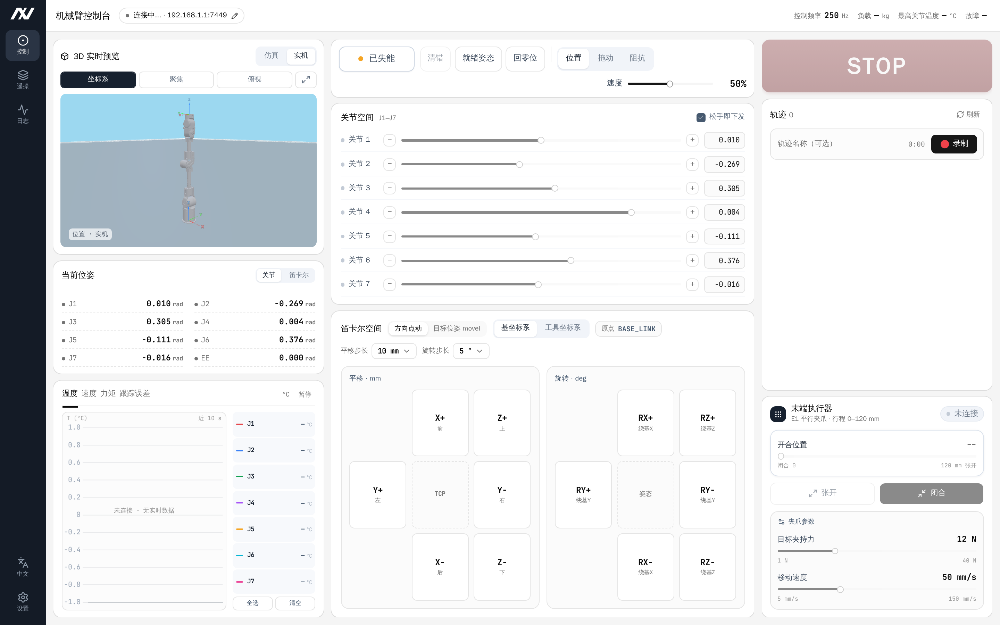

```{=latex}
\begin{titlepage}
\thispagestyle{empty}
\newfontfamily\qsans{Noto Sans CJK SC}
\begin{tikzpicture}[remember picture,overlay]
  % 封面绝对定位，坐标 = 距页面左上角 (pt)。对齐参考封面 LiteArm_Quickstart 首页：
  % 英文名中心 y≈205 / 手册名 y≈262 / 图顶 y≈300 / 品牌行 y≈716 / 版本行 y≈746
  % 品牌 logo（机械臂图形+字标，替换原 LITEARM SE 文字）：图顶 y≈108、高 112pt
  \node[anchor=north,inner sep=0pt] at ($(current page.north west)+(298.75pt,-108.9pt)$)
      {\includegraphics[width=100pt,height=112pt,keepaspectratio]{LITEARM_SE_images/cover_litearm_logo.png}};
  \node[anchor=center] at ($(current page.north west)+(298.75pt,-262.4pt)$)
      {{\fontsize{28}{34}\selectfont\qsans\bfseries 软件开发手册}};
  \node[anchor=north,inner sep=0pt] at ($(current page.north west)+(298.75pt,-300.8pt)$)
      {\includegraphics[width=289.1pt,height=289.1pt,keepaspectratio]{LITEARM_SE_images/cover_litearm_se.png}};
  \node[anchor=center] at ($(current page.north west)+(298.75pt,-717.8pt)$)
      {{\fontsize{11}{14}\selectfont\bfseries NEXFORM ROBOTICS}};
  \node[anchor=center] at ($(current page.north west)+(298.75pt,-747.9pt)$)
      {{\fontsize{9}{13}\selectfont\qsans 版本：V1.0.4\qquad 日期：2026年10月16日}};
\end{tikzpicture}
\end{titlepage}
\pagenumbering{Roman}
\thispagestyle{frontmatter}
\section*{修订记录}
```

| 版本 | 修订时间 | 修订记录 |
|---|---|---|
| V1.0.4 | 2026-10-16 | 控制架构改为板载控制板 + USB 直连，按 litearm-python 重写 SDK 章节；精简上位机章节 |
| V1.0.3 | 2026-09-03 | 更新上位机说明 |
| V1.0.2 | 2026-08-20 | 更新 SDK 说明 |
| V1.0.1 | 2026-07-15 | 新建 LITEARM SE 软件开发手册框架 |

```{=latex}
\clearpage
\thispagestyle{frontmatter}
\tableofcontents
\clearpage
\pagenumbering{arabic}
\makeatletter\def\fps@figure{H}\makeatother
```


# 前言

SDK、上位机软件与配套文档均托管在 GitHub：

- **NEXFORM ROBOTICS 组织主页**：<https://github.com/nexform-tech>
- **机械臂开箱与安装教程**（开箱清点、桌面固定、立柱安装、电气连接）：<https://github.com/nexform-tech/litearm-setup>

> 本手册只讲软件。机械装配与电气连接不在本手册范围内，请从上面的安装教程获取。

## 硬件组成

从软件开发视角，使用 LITEARM SE 需要以下硬件/组件：

| 组成 | 说明 | 开发要点 |
|---|---|---|
| 机械臂本体 | LITEARM SE，7 关节 | 经配套线缆接至控制板 |
| 控制板 | 板载控制器，随臂交付，运行固件 | 承担轨迹规划、正逆运动学、动力学与控制律；上位机经 USB 直连 |
| 上位机 PC | 运行 Python / C++ / ROS 2 / 仿真 | 只需一个可用 USB 口，无需 CAN 硬件、无需配置网络 |
| 电源模块 | 600 W（带泄放），选配 | 输出经 XT60 接至控制板（接线步骤见《LITEARM-SE 机械臂安装教程》） |
| 末端设备（可选） | 夹爪等 | 由对应产品的 SDK 驱动 |

控制链路：`客户端程序 → USB（虚拟串口）→ 控制板固件 → CAN（板内）→ 关节`。**规划与控制全部在控制板固件中完成**，PC 侧 SDK 只负责编解码帧、下发命令与判到位。每个 `Arm` 会话独占一个串口，因此同一台机械臂同一时刻只能有一个进程持有它。

## 单位说明

与 SDK / 产品手册一致：位置单位为 m、姿态与关节角单位为 rad、速度 1.0 表示归一化速度（关节运动时由固件按内部规划比例解释，详见「位姿、单位与运动学」一节），质量 kg、力/扭矩 N / N·m。

位姿使用 **6 个数**：`pose = (x, y, z, rx, ry, rz)`，前 3 个为位置（m），后 3 个为姿态（rad，绕基坐标系 X/Y/Z 轴的 RPY 角）。list 与 tuple 均可，例如 `(0.30, 0.0, 0.40, 3.1416, 0.0, 0.0)`。SDK 也兼容「位置 3 个数 + 3×3 旋转矩阵」的写法，详见「位姿、单位与运动学」一节。

## 安全须知

### 简介

二次开发时除硬件安全外，还需注意软件侧安全语义。开发/调试人员应经过培训，理解关节空间与笛卡尔空间的运动差异、使能/失能与急停语义，以及软限位与碰撞检测的作用。安全细节以《LITEARM SE 产品手册》第 1.3 节为准。

### 安全警示标志

本手册及配套产品手册使用如下四类安全警示标志（图样以产品随附标识为准）：

```{=latex}
\noindent\textbullet{}~\textbf{危险}：用于可能导致人员伤亡或设备严重损坏的危险情况。\par
\vspace{0.4em}\noindent\makebox[\linewidth][c]{\includegraphics[width=0.095\linewidth]{LITEARM_SE_images/safety/danger.png}}\par
\vspace{1em}
\noindent\textbullet{}~\textbf{警告}：用于如不避免，可导致人员伤亡或设备严重损坏的危险情况。\par
\vspace{0.4em}\noindent\makebox[\linewidth][c]{\includegraphics[width=0.095\linewidth]{LITEARM_SE_images/safety/warning.png}}\par
\vspace{1em}
\noindent\textbullet{}~\textbf{高温}：用于存在高温部件、接触可能造成灼烫伤害或设备损坏的危险情况。\par
\vspace{0.4em}\noindent\makebox[\linewidth][c]{\includegraphics[width=0.095\linewidth]{LITEARM_SE_images/safety/high_temp.png}}\par
\vspace{1em}
\noindent\textbullet{}~\textbf{注意}：用于如不避免，可能导致人员伤害或设备损坏的一般警示。\par
\vspace{0.4em}\noindent\makebox[\linewidth][c]{\includegraphics[width=0.095\linewidth]{LITEARM_SE_images/safety/notice.png}}\par
```

### 安全注意事项（软件侧）

1. **`disable()` 会使电机关力，机械臂在重力作用下坠落**，禁止在无支撑或人员靠近时调用；`enable()` 可使能并保持当前姿态。
2. 运动前确保急停可立即触达、工作区清空；首次运动用保守速度（如 `speed=0.1~0.2`）。
3. `home()` 与零重力拖动（`zero_g()`）具有特殊安全语义：`home()` 须先 `enable()`，且固件把其速度写死为 0.10；`zero_g()` 退出前必须把各关节推回软限位以内（越限锁存一旦生效不受使能门控、`reset()` 也清不掉）。
4. 修改 `params.set_joint_limits()` / `set_payload()` / `set_gravity_vector()` / `set_gravity_scale()` / `params.set_joint_param()` 等参数前应做安全评估；不正确的负载质量/质心或重力方向会导致补偿错误甚至失控。
5. 高频直接控制（`send_mit` / `send_mit_all` / `move_js` / `joint_follow`）绕过固件规划，属高级功能，仅由具备控制与安全经验的工程人员使用，且**必须 ≥10 Hz 自行保活**。
6. 下列命令会覆盖或抹掉该台设备的动力学标定且**不可逆**，不得在已标定的机械臂上执行：`save_params()`、`model.commit()`、`params.reset_factory()`、`model.revert()`。
7. 固件承担斜率限制、软限位、非法值拒绝、通信看门狗与急停兜底，**不依赖上位机在线**；但这只是硬性兜底，不能替代上层程序自身的参数校验。
8. 仿真通过不等于实机安全；迁移到实机仍需低速、低负载逐步验证。

### 责任及规范

用户对二次开发形成的完整系统的安全负责，进行风险评估与防护设计；对违反使用要求或不可抗力造成的损害，我司不承担相应责任。详见产品手册 1.3.4。

### 风险评估

参照产品手册 1.3.5，软件触发类风险（如远端指令导致机械臂高速运动、负载坠落）也应纳入风险评估。

---

# SDK 使用指南

## 简介

LITEARM SE 软件侧采用 **“客户端 SDK / 上层框架 → USB → 控制板固件 → CAN → 关节”** 的分层架构。**轨迹规划、正逆运动学、动力学与控制律全部在控制板固件中完成**，PC 侧 SDK 只负责编解码帧、下发命令与判断是否到位。Python、C++ 客户端接口语义一致；ROS 2 与仿真适配均基于同一套控制链路。

| 层级 | 典型组件 | 作用 |
|---|---|---|
| 应用层 | 用户 Python/C++ 程序、ROS 2 节点、LeRobot 策略 | 业务逻辑、算法、轨迹或策略 |
| SDK / 适配层 | litearm-python / litearm-cpp | 状态读取、运动控制、参数管理 |
| 固件层 | 控制板固件 | 规划、运动学、动力学、控制律与安全兜底 |
| 硬件层 | 控制板 + CAN + LITEARM SE 关节 | 关节执行与状态反馈 |

**连接约定**

- 上位机与控制板之间**只用一根 USB 线**：USB CDC 虚拟串口，VID:PID `1d50:606f`，波特率 921600。**无需配置 IP 或网络**。
- 端口可不指定——`Arm(port=None)` 会按 VID:PID 自动发现控制板；也可显式传入，如 `Arm(port="/dev/ttyACM0")`。SDK **不读取任何环境变量**。
- 一次会话独占串口，同一台机械臂同一时刻只能被一个进程持有（详见「连接与最小示例」一节）。
- 本文以 **Python SDK（litearm-python）** 为主线；C++、ROS 2 与仿真生态见「其他语言与软件生态概述」一节。

## 库相关依赖

| 语言/框架 | 库 | 关键要求 | 状态 |
|---|---|---|---|
| Python | litearm-python | Python ≥ 3.9；唯一依赖 `pyserial >= 3.4`；无需 CAN 硬件 | 主线 |
| C++ | litearm-cpp | C++17、CMake ≥ 3.14；无第三方依赖（标准库 + 平台串口 API） | 提供 |
| ROS 2 | litearm-ros2 / litearm-ros2-control | ROS 2 Humble；ros2_control 版经 litearm-cpp 直接驱动 | 提供 |
| URDF/RViz | litearm-description | 标准 URDF 描述包，供 RViz / MoveIt 2 / 仿真共用 | 提供 |
| MoveIt 2 | litearm-moveit2 | ROS 2 Humble + MoveIt 2 | 提供 |
| MuJoCo | litearm-mujoco | pip 安装；`MujocoArm` 仿真接口 | 提供 |
| PyBullet | litearm-pybullet | pip 安装；`PyBulletArm` 接口与 litearm-python 对齐 | 提供 |
| Isaac Sim | litearm-isaacsim | NVIDIA Isaac Sim 仿真环境 | 提供 |
| LeRobot | litearm-lerobot | litearm-python；lerobot 数据集录制与策略适配 | 提供 |
| 上位机 | litearm-studio | Python 3.10+；图形化控制台 | 提供 |

> 控制板固件版本需为 `Litearm1.5.0` 及以上。版本串形如 `Litearm1.5.0-7J`——`Litearm` + 三段版本号 + `-7J`（七轴）或 `-1J`（单轴台架）。版本过低或串不符合该命名约定时，`connect()` 会直接拒绝。

## Python 库安装与使用（主线）

### 安装

```bash
git clone https://github.com/nexform-tech/litearm-python.git
cd litearm-python
pip install -e .                  # 安装（正式交付建议锁定版本）
python3 -c "import litearm; print(litearm.__version__)"   # 验证
```

安装后同时提供命令行入口 `litearm-python`（等价写法 `python -m litearm`，见「只读属性与命令行」一节）。

### 依赖与运行环境

- Python：**≥ 3.9**。
- 依赖：**`pyserial >= 3.4`（唯一依赖）**；不需要 numpy，不需要任何 CAN 硬件或中间件。
- 驱动/权限：Linux 下需把当前用户加入串口权限组，重新登录后生效：

```bash
sudo usermod -aG dialout $USER
```

- 支持 Windows / Linux / macOS。

### 连接与最小示例（先跑只读）

```python
import litearm as pa

with pa.Arm().connect() as arm:          # 不指定端口则按 VID:PID 自动发现控制板
    print(arm.firmware, arm.n)           # 固件版本串、关节数
    state = arm.get_state().value        # 读值要走 .value，见「读值」一节
    print(state.q, state.dq, state.tau)  # 关节角 / 速度 / 力矩
    print(arm.get_tcp().value)           # 当前末端位姿（6 个数）
```

要点：

- **`Arm().connect()` 是唯一入口**。`connect()` 返回时握手已完成，`arm.n` / `arm.firmware` 一定可用。
- `Arm` 支持上下文管理器（`with`），退出自动 `close()`；也可手动连接后调用 `arm.close()`。**每个会话背后有一条后台读线程，用完必须关闭**。
- 手动指定端口（多台设备或自动发现失败时）：`pa.Arm(port="/dev/ttyACM0").connect()`。

### 读值：`Msg` 信封与 `RobotState`

11 个「读一帧」接口返回信封 `Msg`，**数据本身在 `.value` 里**——直接打印 `Msg` 看到的是信封，不是状态。

```python
@dataclass(frozen=True)
class Msg(Generic[T]):
    value: T          # 原始返回值（取不到帧时是 None）
    hz: float         # 这类帧在本会话的平均到达频率
    timestamp: float  # 最近一帧的本地时刻（从未收到为 0.0）

print(arm.get_state())            # Msg(value=RobotState(...), hz=100.2, timestamp=...)
print(arm.get_state().value.q)    # [0.0, 0.0, 0.0, 0.0, 0.0, 0.0, 0.0]
```

- `get_state()` 消费控制板持续推送的状态帧（约 100 Hz），无往返开销。
- `get_status_now()` 会**主动发一条查询**，可用于确认链路活性；本会话还没收到过任何帧时它抛 `MotionTimeoutError`。
- **`hz == 0.0` 且 `timestamp == 0.0` 表示这类帧从没到过**，而不是"链路慢"。

`RobotState` 主要字段与派生属性：

| 字段 / 属性 | 说明 |
|---|---|
| `mode` / `mode_name` | 当前模式及其名称 |
| `flags` / `flag_names` | 标志位与名字 |
| `seq` | 状态帧到达序号，用来判断数据流是否还在动 |
| `joints` | `list[JointState]`，每项含 `q` / `dq` / `tau` / `t_mos` / `t_coil` / `err` |
| `joint_fault` | 逐轴掉线位图 |
| `n` / `enabled` / `cart_busy` | 关节数 / 是否使能 / 笛卡尔运动是否在进行 |
| `q` / `dq` / `tau` | 各关节角（rad）、角速度（rad/s）、力矩（N·m） |
| `fault_axes` / `faulted` / `fault_detail` | 故障轴与故障详情 |

### 运动控制（关节 / 笛卡尔）

```python
import litearm as pa

with pa.Arm().connect() as arm:
    arm.enable()                                    # 运动之前必须先使能

    # 关节空间：q 为 7 元素关节角（rad），固件规划 S 曲线并自己走完
    arm.movej([0.0, 0.0, 0.0, 0.0, 0.0, 0.0, 0.0], speed=0.2)
    arm.movej_sync([0.3, 0.0, 0.0, 0.0, 0.0, 0.0, 0.0], speed=0.2)   # 各轴一起到位

    # 笛卡尔直线：位姿 = 6 个数（位置 3 + RPY 3）
    P1 = (0.30, 0.0, 0.40, 3.1416, 0.0, 0.0)
    P2 = (0.32, 0.0, 0.42, 3.1416, 0.0, 0.0)
    P3 = (0.34, 0.0, 0.44, 3.1416, 0.0, 0.0)
    arm.move_l(P2, speed=0.5)                       # 直线
    arm.move_path([P1, P2, P3], speed=0.5)          # 依次过路点（尖角）
    arm.move_c(arm.get_tcp().value, P2, P3)         # 圆弧（起点必须是实测 TCP）

    arm.home()                                      # 回零
```

| 接口 | 末端走什么 / 说明 |
|---|---|
| `movej(q, speed=1.0)` | 关节空间单发，固件规划 S 曲线并走完，到位后静止保持。**不校验关节限位**，越限目标会被固件截断后走满行程 |
| `movej_sync(q, speed=1.0)` | 关节空间同步点到点，各轴一起到位 |
| `home(*, timeout=None)` | 回零。**须先 `enable()`**；固件把速度写死为 0.10，不接受 `speed` 参数（写 `arm.home(speed=0.3)` 会抛 `TypeError`） |
| `move_js(q, dq=None, tau_ff=None)` | 低层关节流，绕过规划；需调用方 ≥10 Hz 重发（见「透传与伺服」一节） |
| `move_p(pose, speed=1.0, pos_tol=0.006, rpy_tol=0.03)` | 关节空间插值的点到点，**末端不走直线**；只收单个位姿 |
| `move_l(pose, speed=1.0, wait=True)` | 笛卡尔直线（位置线性 + 姿态球面插值） |
| `move_c(pose_start, pose_via, pose_goal, speed=1.0, wait=True)` | 圆弧（三点定圆，`via` 的姿态被忽略）；`start` 必须与调用时的实测 TCP 一致 |
| `move_path(poses, speed=1.0, wait=True)` | 依次经过多个路点，**转角是尖角**（无倒角） |
| `poll_cart()` | 查询笛卡尔进度的待认领队列（配合 `wait=False`） |
| `set_speed(percent)` | 全局、**持续**的调速器。`percent` 是 **0..100 的整数百分比**——`set_speed(1)` 是 1% 速度，不是"满速" |

> `movej` / `movej_sync` / `move_p` / `home` 返回 `RobotState`；`move_l` / `move_c` / `move_path` 返回 `CartPlan`。`speed` 取 0~1 归一化比例（`set_speed` 除外）。笛卡尔规划被拒时抛 `CartesianPlanError`，**整条拒绝、机械臂一步没动**。
>
> **`movej` 返回 ≠ 停稳**：残差约 0.012 rad（在到位容差内）。需要精确停稳时请自行加稳定延时或读状态确认。

### 位姿、单位与运动学

- **位姿格式**：`pose = (x, y, z, rx, ry, rz)`，前 3 个为位置（m），后 3 个为姿态（rad，绕基坐标系 X/Y/Z 轴的 RPY 角）。list 与 tuple 均可。**注意不是欧拉角以外的旋转矩阵形式，也不是四元数**。
- SDK 也兼容「位置 3 个数 + 3×3 旋转矩阵」的写法：

```python
arm.move_p(([0.30, 0.0, 0.35], [[1, 0, 0], [0, 1, 0], [0, 0, 1]]))
```

- **逆运动学**：`ik(pose, q_seed=None, timeout=3.0) -> list[float]`，失败抛 `IKError`。它可能返回另一个同样有效的分支，与 `q_seed` 差得远未必是错误。

```python
q = arm.ik((0.30, 0.0, 0.35, 3.1416, 0.0, 0.0))
```

- **没有 `fk(q)`**：PC 侧不带运动学模型（正运动学只有固件能做）。读取当前末端位姿请用 `get_tcp()`。

### 生命安全与状态控制

| 功能 | 接口 | 说明 |
|---|---|---|
| 使能 | `enable(attempts=12)` | 使能全部关节并保持当前姿态；重试只对固件白名单里可重试的码生效 |
| 失能 | `disable()` | 切断位置环，**机械臂不再被托住，会在重力作用下下落** |
| 急停 | `emergency_stop()` | 单帧、单向、不读状态，**唯一没有前置条件的入口** |
| 复位 | `reset()` | 清故障 + 重锚控制环（**不是 MCU 重启**，同一对象仍可用） |
| 清故障 | `clear_faults()` | 只清 RAM 故障位，不写 Flash |
| 模式 | `set_motion_mode(mode)` / `park()` | 固件只认 `0`，其它值本地抛 `InvalidCommandError`；`park()` 等价于 `set_motion_mode(0)` |
| 零重力 | `zero_g()` | 上下文管理器，重力补偿下自由拖动（拖拽示教），见「拖动示教（零重力）」一节 |

### 参数配置与前馈调参

| 功能 | 接口 | 说明 |
|---|---|---|
| 负载 | `set_payload(mass, com=(0.0, 0.0, 0.0))` | 末端负载质量（kg）与质心；**补偿正确性依赖此参数**，换负载必须重设 |
| 重力方向 | `set_gravity_vector(g)` | 基座安装方向（正装/侧装/倒装）通过重力方向体现 |
| 重力前馈 | `set_gravity_scale(gs)` / `set_inertia_scale(isc)` | 逐关节缩放重力/惯量前馈，长度须等于关节数 |
| 前馈开关 | `set_ff_mask(mask)` / `get_ff_mask()` / `ff_preset(preset)` | `preset`：0 全关 / 1 出厂 / 2 全开 |
| 前馈向量/标量 | `set_ff_vec(item, values)` / `set_ff_scalar(item, sub, value)` / `get_ff_vec(item)` / `get_ff_scalar(item, sub=0)` | 读写动力学/控制律参数（`item` / `sub` 语义以固件参数表为准） |
| 关节参数 | `arm.params.set_joint_param(idx, kp, kd, tau_max)` / `get_joint_param(idx)` / `all_joint_params()` | 逐关节 kp / kd / 扭矩上限；修改前安全评估 |
| 关节限位 | `arm.params.set_joint_limits(idx, q_min, q_max)` | 软限位；**只允许收窄**，写回当前值会被判为放宽请求并拒绝 |

> 以上写入的都是 RAM，需要掉电保持时调用 `save_params()` 写 Flash（**不可逆**）。

### 拖动示教（零重力）

```python
arm.enable()                        # 进入前必须已使能
with arm.zero_g():
    input("拖动机械臂，然后回车")
```

- `zero_g()` 是上下文管理器（由 `zero_g_start()` + `zero_g_stop()` 组合而成），进入后固件用虚拟弹簧与阻尼让机械臂"变软"，可徒手拖动示教。
- 保活由 SDK 后台线程按 `period`（默认 0.04 s，须在 `[0.005, 0.10)` 内）自动重发，调用方不用管。
- 保活期间其它**动作**命令会被拒（急停、失能例外；查询类不受限）。
- **退出前必须把各关节推回软限位以内**：零重力会跳过位置越限锁存，而一旦退出，锁存立刻生效且不受使能门控、`reset()` 也清不掉。
- 退出是异步的，`zero_g_stop()` 返回后固件侧还要一点时间收尾；只读属性 `zero_g_active` / `zero_g_error` 可查状态。

### 透传与伺服

绕过固件规划，直接以 MIT 参数逐帧驱动关节——**调用方必须自己保活，≥10 Hz 重发**，否则 0.1 s 看门狗进入 fail-soft（降刚度 + 力矩归零），机械臂会在重力下缓慢塌下去。

| 接口 | 说明 |
|---|---|
| `send_mit(idx, q, dq, kp, kd, tau)` | 单关节 MIT 五参数逐帧直接控制 |
| `send_mit_all(q, dq, kp, kd, tau)` | 全关节；五个数组长度都必须等于关节数，且必须是有限数 |
| `joint_follow(q, dq, kp, kd)` | 帧里不带前馈的 `send_mit_all`，前馈由固件每拍自己算，跟随环因此省掉一次往返 |
| `move_js(q, dq=None, tau_ff=None)` | 低层关节流；`dq` 是速度参考，不是速率上限 |

> 本组入口在真机上未经完整验证，请谨慎使用。任何其它运动/停止命令都会结束当前透传会话。

### 关节参数、动力学模型、数据采集与固件自检

四个子命名空间对象，均为 `arm.` 下的属性：

| 对象 | 主要接口 | 用途 |
|---|---|---|
| `arm.params` | `set_joint_param(idx, kp, kd, tau_max)`、`set_joint_limits(idx, q_min, q_max)`、`get_joint_param(idx)`、`all_joint_params()`、`reset_factory()` | 关节级参数（kp / kd / 扭矩上限 / 软限位） |
| `arm.model` | `probe()`、`get_body(idx)`、`set_body(idx, vals)`、`get_gravity(q)`、`status()`、`commit(expected_mask)`、`revert()` | 动力学模型的在线导入与回滚 |
| `arm.log` | `start(n_ticks)`、`stop()`、`reader()`、`capture(n_ticks)`、`dump(path)` | 300 Hz 控制拍采集（`LOG_MAX_SAMPLES = 2400`，约 8 s 记满自停） |
| `arm.diag` | `kin_bench()` | 固件自检与 CAN 链路诊断计数 |

```python
for jp in arm.params.all_joint_params():
    print(jp.idx, jp.kp, jp.q_min, jp.q_max)

arm.log.start(300)                  # 录 300 拍后自停
r = arm.log.reader()
for s in r.samples()[:3]:
    print(s.tick, s.q_ref, s.dq, s.tau)
```

> `arm.params.set_joint_limits()` **只允许收窄**，不幂等，不要拿它做读写回环。`arm.model.set_jm()`（改关节映射）建议永不调用——改错有乱飞风险，且本机唯一的恢复手段本身也不可逆。

### 授权、固件升级与参数持久化

| 接口 | 说明 |
|---|---|
| `license(timeout=1.0)` | 读取授权记录（返回裸 `LicenseInfo`，不是 `Msg`） |
| `activate(*, cust_id, issued, flags=0, mac, timeout=2.0)` | 提交厂商签发的凭据；**须先 `disable()`** |
| `enter_dfu(timeout=0.3)` | 免探针进入 ROM bootloader，用于刷写固件；**唯一的终端态操作** |
| `save_params()` | 把当前 RAM 参数写入 Flash，**不可逆** |

- 设备出厂即锁定，**未激活的机械臂 `enable()` 会被拒**（其余命令照常，以便现场诊断），激活记录**写一次、永不擦除**。
- `enter_dfu()` 后本 `Arm` 对象不可再用（所有入口抛 `ArmIsInDfuError`，`close()` 例外）；设备会重新枚举为 `0483:DF11`，需等待 USB 重新枚举后再刷写，刷完新建一个 `Arm`。

### 只读属性与命令行

```python
print(arm.n, arm.firmware, arm.fw_version)      # 关节数 / 版本串 / 版本元组
print(arm.q_tol, arm.dq_tol, arm.move_timeout)  # 到位判据与运动超时
print(arm.zero_g_active, arm.last_reset_reason)
```

命令行入口 `litearm-python`（等价写法 `python -m litearm`）：

```bash
litearm-python status                          # 只读
litearm-python fw                              # 版本串 + 轴数
litearm-python tcp                             # 当前位姿 + 帧率
litearm-python movej -0.1 0 0 0 0 0 0 --speed 0.3
litearm-python home
```

> `status` / `fw` / `tcp` 只读，其余会真的驱动机械臂。`movej` 的目标个数必须正好等于 `arm.n`。

### 核心 API 速查

| 类别 | 接口 |
|---|---|
| 连接 | `Arm(port=None)`、`connect()`、`close()`、`disconnect()`、`reconnect()` |
| 状态 | `get_state()`、`get_status_now()`、`get_tcp()` |
| 运动学 | `ik(pose, q_seed=None)`（无 `fk()`） |
| 运动 | `movej()`、`movej_sync()`、`home()`、`move_p()`、`move_l()`、`move_c()`、`move_path()`、`poll_cart()`、`set_speed()` |
| 安全 | `enable()`、`disable()`、`emergency_stop()`、`reset()`、`clear_faults()`、`set_motion_mode()`、`park()` |
| 拖动示教 | `zero_g()`、`zero_g_start()`、`zero_g_stop()` |
| 透传 | `move_js()`、`send_mit()`、`send_mit_all()`、`joint_follow()` |
| 前馈 / 动力学 | `ff_preset()`、`set_ff_mask()`、`get_ff_mask()`、`set/get_ff_vec()`、`set/get_ff_scalar()`、`set_gravity_vector()`、`set_gravity_scale()`、`set_inertia_scale()`、`set_payload()` |
| 关节参数 | `arm.params.*` |
| 动力学模型 | `arm.model.*` |
| 数据采集 | `arm.log.*` |
| 固件自检 | `arm.diag.kin_bench()` |
| 授权 / 固件 | `license()`、`activate()`、`enter_dfu()`、`save_params()` |

### 异常与错误处理

全部异常继承自 `LiteArmError`。固件明确回绝的命令抛 `CommandRejectedError`，并带 `.cmd` / `.code` 两个字段。

```python
from litearm import (
    LiteArmError, NotConnectedError, TransportError, FirmwareMismatchError,
    InvalidCommandError, MotorFaultError, MotionTimeoutError, IKError,
    CommandRejectedError, UnsupportedByFirmwareError, CartesianPlanError,
)

try:
    arm.movej([0.0]*7, speed=0.5)
except MotorFaultError as e:
    print("motor fault:", e)              # 状态帧出现 FAULT 或 EMERGENCY
    arm.reset()                           # 清故障 + 重锚控制环
except IKError as e:
    print("ik failed:", e)                # 反解失败 / 目标不可达
except CartesianPlanError as e:
    print("cartesian plan failed:", e)    # 固件规划被拒（无解/共线/超容量）
except CommandRejectedError as e:
    print("rejected:", e.cmd, e.code)     # 固件回 ERR{cmd, code}
```

> `except InvalidCommandError` **不覆盖** `CartesianPlanError`：后者直挂 `LiteArmError`，因为它表达的是固件规划结论，而不是命令被拒绝。错误码里 `code == 0x00` 恒表示固件没有这条命令（`UnsupportedByFirmwareError`）。

## 其他语言与软件生态概述

LITEARM SE 的控制通路只有一条：**上位机经 USB 直连控制板**。所有官方 SDK 都是这条通路的不同语言封装，规划、正逆运动学与动力学一律在控制板固件里完成，上位机只负责下发目标、读回状态并判到位。

### C++ SDK（litearm-cpp）

`litearm-python` 2.1.0 的 C++ 移植：同一套线上协议、同一套语义与安全判据，逐行对应。

| 项目 | 要求 |
|---|---|
| 编译器 | C++17（g++ 7+ / clang 6+ / MSVC 2019+） |
| 构建 | CMake ≥ 3.14 |
| 第三方依赖 | **无**——只依赖 C++ 标准库与平台自带串口 API（POSIX termios / Win32） |
| 固件 | `Litearm1.5.0` 或更新 |
| 连接 | USB CDC 串口，`VID:PID 1d50:606f` 自动发现 |

```cpp
#include <litearm/litearm.hpp>

int main() {
    litearm::Arm arm;                 // 不传端口：按 VID:PID 1d50:606f 自动发现
    arm.connect();
    arm.movej({0.0, 0.0, 0.0, 0.0, 0.0, 0.0, 0.0}, 0.2);
    arm.close();
    return 0;
}
```

命名空间为 `litearm`，类为 `litearm::Arm`，头文件位于 `include/litearm/`，构建产物是单个静态库 `liblitearm.a`。

### ROS 2

两个**互斥**入口，都与控制板直连、都没有守护进程，也都经 `litearm-cpp` 打开串口：

| 仓库 | 角色 |
|---|---|
| `litearm-ros2-control` | ros2_control 的 `SystemInterface` 插件，由 `joint_trajectory_controller` 或 MoveIt 2 驱动，用于运动控制 |
| `litearm-ros2` | 独立维护驱动节点（生命周期节点 + 55 个服务），用于控制回路之外的开机验收、授权与参数调试 |

> **两者绝不可同时运行**：它们打开的是同一个 USB CDC 串口，SDK 会对其加独占 `flock`，第二个进程直接打不开。

`litearm-description` 提供各型号的 URDF 描述（SE 在 `SE/litearm_description/`），`litearm-moveit2` 提供 MoveIt 2 配置包 `litearm_moveit_config`。详细的启动步骤见下一节。

### 仿真与具身生态

| 仓库 | 状态 |
|---|---|
| `litearm-pybullet` | 与 `litearm-python` **1:1 对齐**：同样的 31 个方法名、参数与默认值，同样返回 `Msg` / `RobotState` / `CartPlan`，位姿同样是 6 个数 |
| `litearm-mujoco` | 用法与 `litearm-python` 一致，但目前仍按旧接口编写：用 `movel` / `get_tcp_pose()` 与「位置 3 个数 + 3×3 旋转矩阵」位姿，尚未迁移到新接口 |
| `litearm-isaacsim` | 三节点单向同步：API 命令发布 → 真机执行 → Isaac Sim 跟随真机**实测**关节角，因此任何方式产生的运动（含拖拽示教）仿真都会跟上 |
| `litearm-lerobot` | LeRobot 的 `Robot` 适配器：观测 `observation.state` 为 7 个绝对关节角、动作 `action` 为 7 个关节目标，可录制 `LeRobotDataset` |

```python
from litearm_pybullet import PyBulletArm

with PyBulletArm(render=True) as arm:            # connect() 隐含
    arm.movej([0.0, 0.6, 0.0, -1.2, 0.0, 0.7, 0.0], speed=0.2)
    x, y, z, r, p, yw = arm.get_tcp().value      # 6 个数，不是旋转矩阵
    arm.move_l([x, y, z - 0.1, r, p, yw], speed=0.1)
```

### 参考仓库

| 组件 | 仓库 |
|---|---|
| Python SDK | https://github.com/nexform-tech/litearm-python |
| C++ SDK | https://github.com/nexform-tech/litearm-cpp |
| ROS 2 控制栈 | https://github.com/nexform-tech/litearm-ros2-control |
| ROS 2 维护驱动 | https://github.com/nexform-tech/litearm-ros2 |
| URDF 描述 | https://github.com/nexform-tech/litearm-description |
| MoveIt 2 | https://github.com/nexform-tech/litearm-moveit2 |
| 上位机软件 | https://github.com/nexform-tech/litearm-studio |
| 安装教程 | https://github.com/nexform-tech/litearm-setup |
| MuJoCo | https://github.com/nexform-tech/litearm-mujoco |
| PyBullet | https://github.com/nexform-tech/litearm-pybullet |
| Isaac Sim | https://github.com/nexform-tech/litearm-isaacsim |
| LeRobot | https://github.com/nexform-tech/litearm-lerobot |

## ROS 2 环境的使用

ROS 2 侧**不经过任何 Python 桥接进程**：ros2_control 插件自己持有机械臂的 USB CDC 链路，走 `litearm-cpp`，`read()` 取 SDK 缓存好的状态帧，`write()` 用固件的 `MOVE_JS` 伺服把指令参考发回。规划、正逆运动学与动力学仍留在固件里。

### 环境与准备

| 项目 | 要求 |
|---|---|
| ROS 2 | Humble |
| 构建 | `ament_cmake`，C++17 |
| SDK | `litearm-cpp`——已安装，或作为同级源码树 |
| 固件 | `Litearm1.5.0` 或更新 |
| 连接 | USB CDC 串口，`VID:PID 1d50:606f` |
| 串口权限 | Linux 下 `sudo usermod -aG dialout $USER`，重新登录后生效 |

低于 1.5.0 的固件会在连接阶段被拒绝：控制栈依赖 1.5.0 才引入的状态帧布局、`joint_fault` 字段与使能位。

工作区布局如下（同一工作区只保留一份机械臂描述）：

```text
~/litearm_ws/src/
├── litearm-cpp/              # C++ SDK
├── litearm-description/      # URDF 描述（包名 litearm_description）
└── litearm-ros2-control/     # ros2_control 插件
```

```bash
source /opt/ros/humble/setup.bash
cd ~/litearm_ws
colcon build
source install/setup.bash

lsusb | grep 1d50              # 应看到 1d50:606f
ls /dev/ttyACM*                # 应看到 /dev/ttyACM0
```

### 启动控制栈

```bash
ros2 launch litearm_ros2_control litearm_control.launch.py
```

| 参数 | 默认值 | 含义 |
|---|---|---|
| `port` | `''` | USB CDC 路径。留空按 `1d50:606f` 自动发现；接多块板时写 `port:=/dev/ttyACM1` |
| `clear_faults` | `true` | 配置时清一次锁存故障，使「故障之后」仍然是一条命令；`false` 让锁存故障拦住启动 |
| `start_joint_state_broadcaster` | `true` | 拉起并激活 `joint_state_broadcaster` |
| `start_joint_trajectory_controller` | `true` | 拉起并激活 `joint_trajectory_controller` |
| `ros_domain_id` | `42` | 本栈的 ROS 域，刻意避开 0 |
| `ros_localhost_only` | `true` | 只在本机发现，避免同网段第二台机械臂出现在 RViz 里 |

栈起来之后，机械臂就是一个普通的 ros2_control 系统：给 `arm_controller`（一个 `joint_trajectory_controller`）发轨迹，或者在 MoveIt 2 里规划、由 `move_group` 执行。关节名是 `joint1`..`joint7`。

**控制栈 + MoveIt 2 + RViz2**（一条命令，内部包含上面那条）：

```bash
ros2 launch litearm_moveit_config litearm_moveit.launch.py
ros2 launch litearm_moveit_config litearm_moveit.launch.py use_rviz:=false       # 无显示环境
ros2 launch litearm_moveit_config litearm_moveit.launch.py start_control:=false  # 只补 move_group
```

两条 launch 都把域钉在 42 并开启仅本机发现，因此从另一个终端观察前要先导出同样的变量：

```bash
export ROS_DOMAIN_ID=42; export ROS_LOCALHOST_ONLY=1
ros2 node list
```

### 接口映射

每个关节导出三个状态接口和两个命令接口：

| 方向 | 接口 | 固件含义 |
|---|---|---|
| command | `position` | `q_ref`（经 `MOVE_JS` 下发） |
| command | `velocity` | `dq_ref` |
| state | `position` | 实测 `q` |
| state | `velocity` | 实测 `dq` |
| state | `effort` | 实测 `tau`——电流估算值，噪声大，**不可用于控制** |

`export_diagnostic_interfaces` 为 `true`（默认）时，每个关节还会额外导出四个诊断状态接口：

| 接口 | 含义 |
|---|---|
| `temperature_mos` | MOSFET 温度 |
| `temperature_coil` | 线圈温度 |
| `error_code` | 固件故障字 |
| `feedback_age` | 最近一帧状态帧的年龄（s） |

> **指令看门狗**：固件在 100 ms 收不到指令后跳闸，所以 `write()` 必须持续重发；controller manager 的更新率只要不低于 100 Hz 就自动满足。但控制循环活跃时，不要让更新循环卡顿超过约 100 ms——超时后固件退回失效软保持，机械臂会朝负载拉拽的方向垂下去。
>
> 另外要清楚在进程内直接驱动机械臂的取舍：`write()` 会进到 SDK 写一帧并等固件 ACK，上限是 SDK 自己的 1.2 s 超时。链路健康时这是亚毫秒级，USB 链路卡住时则可能把控制循环堵到那个上限。本插件不提供硬实时保证。

### 维护驱动与 RViz 显示

需要在不带 `controller_manager` 的情况下做开机验收、授权与参数调试时，用维护驱动：

```bash
ros2 launch litearm_driver litearm_driver.launch.py
ros2 service call /litearm/get_status litearm_msgs/srv/GetStatus "{}"
ros2 service call /litearm/get_tcp litearm_msgs/srv/GetTcp "{}"
```

维护驱动自己隔离了参数门禁：`allow_motion` 未置位时，任何会让电机上电的服务都会被拒绝，坏参数在**上线之前**就被挡下。它与上一节的控制栈互斥，一次只能跑一个。

只需查看模型、不接真机时，用 URDF 描述包：

```bash
cd ~/litearm_ws/src/litearm-description/SE
colcon build --packages-select litearm_description
source install/setup.bash
ros2 launch litearm_description display.launch.py
```

RViz2 会打开并显示该臂，关节状态 GUI 为每个关节提供一根滑条。运动链为 `base_link → Link1 … → Link7 → ee_frame_link`，网格为 `meshes/` 下的 STL。

## 常见问题与技术支持

### Q&A

**问：关节空间运动和笛卡尔空间运动有什么区别？**
答：关节空间运动（`movej` / `movej_sync`）只关注各关节从当前值过渡到目标值，不保证末端走直线；笛卡尔空间运动关注末端在空间中的轨迹，`move_l` 保证走直线、`move_c` 保证走圆弧、`move_path` 走多路点路径。两者都在控制板固件里规划。

**问：关节角数组与位姿数组的元素含义？**
答：关节角 `q` 为 `[J1, J2, …, J7]`（rad）。位姿为 **6 个数** `(x, y, z, rx, ry, rz)`：位置单位 m，姿态为绕基坐标系 X/Y/Z 轴的 RPY 角，单位 rad。SDK 也兼容「位置 3 个数 + 3×3 旋转矩阵」的写法。

**问：`movej` 返回成功但机械臂不动？**
答：先读状态确认是否失能或存在锁存故障：`arm.get_state().value.enabled` / `.faulted`。未使能时先 `enable()`；有锁存故障时先 `reset()`（清故障 + 重锚控制环）再使能。另外 `movej` 返回只代表指令已被接受——残差约 0.012 rad 在到位容差内即返回，需要精确停稳请自行读状态确认或加稳定延时。

**问：连接不上机械臂怎么办？**
答：依次检查：`lsusb | grep 1d50` 是否出现 `1d50:606f`（没有则查线缆与供电）；`ls /dev/ttyACM*` 是否有设备（固件处于 DFU 时设备会枚举成 `0483:DF11`）；Linux 下当前用户是否已加入 `dialout` 组；串口是否被另一个进程占用（同一串口同一时刻只能被一个进程持有，可用 `fuser -v /dev/ttyACM0` 查）；固件版本是否达到 `Litearm1.5.0`。

**问：换了一台电脑/重新插拔后串口号变了？**
答：设备重枚举后可能从 `/dev/ttyACM0` 变成 `/dev/ttyACM1`。按 `VID:PID 1d50:606f` 自动发现（`Arm()` 不传端口、launch 的 `port` 留空）可以避开这个问题；需要固定写死时，用 `/dev/serial/by-id/` 下的稳定路径而不是 `ttyACM` 编号。

**问：ROS 里看不到 `/joint_states`？**
答：确认 `joint_state_broadcaster` 已激活、机械臂不在故障态，并确认观察终端与 launch 处在同一个 ROS 域（`ROS_DOMAIN_ID=42`、`ROS_LOCALHOST_ONLY=1`）。

**问：能不能同时跑 ros2_control 栈和维护驱动？**
答：不能。两者打开的是同一个 USB CDC 串口，SDK 会对它加独占 `flock`，第二个进程会直接打开失败。一次只跑一个，切换前先确认旧进程已退出。

**问：技术支持渠道？**
答：NEXFORM ROBOTICS 技术团队；GitHub [github.com/nexform-tech](https://github.com/nexform-tech) Issues。

---

# 上位机软件 LiteArm Studio

> 本章为概述。LiteArm Studio 的完整界面说明、操作步骤与排障速查表单独成册，见《LiteArm Studio 操作手册》。

## 软件简介与运行形态

LiteArm Studio 是面向 LITEARM 七自由度（J1–J7）协作机械臂的图形化上位机控制台。它**不再依赖任何后台服务主机**：UI 是浏览器页面，由本机一个 Python 守护进程（`litearm-studio-daemon`）提供，守护进程是**唯一**接触硬件的进程。

```text
浏览器窗口（React UI）
   │  HTTP → 静态资源、/api/health
   │  WS   → 状态下行 / 指令上行
   ▼
litearm-studio-daemon（Python，仅监听回环地址）
   ▼
litearm-python ──USB CDC（1d50:606f）──> 控制板 ──CAN（板内）──> 关节
```

- **守护进程独占机械臂**：自动发现 USB CDC 设备（或用 `--port` 指定），以 50 Hz 从 SDK 缓存的帧里推送归一化状态，所有 SDK 调用都在单线程执行器上串行化。
- **急停与失能走独立通道**：两者在运动进行中依然可达，不会被正在执行的运动堵住。
- **守护进程同时托管 UI**：它提供构建好的前端资源，并以 Chromium `--app=` 窗口打开（回退为普通标签页）。关闭窗口**不会**结束机械臂会话。
- **只监听回环地址**：绑定其它地址会在代码层被拒绝——把一个能驱动机械臂的界面暴露到局域网上被当作事故处理，而不是一个可选设置。

### 启动方式

```bash
cd litearm-studio
pip install -e ../litearm-python
pip install -e "daemon[test]"     # 安装 fastapi/uvicorn 与 litearm-studio-daemon 入口
pnpm install && pnpm build        # 构建守护进程将要托管的 UI

litearm-studio-daemon --fake      # 离线：全程跑在 SDK 的假传输上，不需要硬件
# litearm-studio-daemon           # 真机：自动发现 USB CDC 设备
# litearm-studio-daemon --port /dev/ttyACM1 --http-port 9000 --no-open
```

控制台会打印它实际绑定的地址（默认 `http://127.0.0.1:8765/`，被占用时自动递增）并打开窗口。

每个 release 还附带 Windows / Linux 的单文件可执行程序（`litearm-studio-<版本>-<平台>`）及对应的 `.sha256`。它们已把守护进程、`litearm` SDK 与构建好的 UI 打包在内，目标机器**不需要 Python、不需要 pnpm、也不需要检出仓库**：

```bash
./litearm-studio-0.5.0-linux-amd64 --fake     # 离线，不需要硬件
./litearm-studio-0.5.0-linux-amd64            # 真机，自动发现 USB
```

### 功能范围

| 模块 | 能力 |
|---|---|
| 单臂运动控制 | 基于 URDF 的实时 3D 数字孪生（含坐标系辅助线）；J1–J7 关节滑条（范围取自固件软限位）与批量下发；基坐标系 / 工具坐标系下的笛卡尔点动，以及到目标位姿的直线运动；就绪姿态、固件回零、零重力拖动示教、使能 / 失能、清错；运动过程中依然可达的高优先级 STOP 急停 |
| 遥测 | 10 Hz 关节采样（角度、速度、力矩、温度、驱动器错误码）；浏览器端 IndexedDB 会话录制，配额可在 10–500 MB 之间配置，支持 CSV 导出 |
| 国际化 | 英文 / 简体中文 |



> **本版本尚未包含**：轨迹示教录制 / 回放、控制服务日志页面、夹爪与灵巧手面板、逐关节阻抗或保持模式。设置与校定页面（负载、增益、限位、自检）目前也还没有接到守护进程上——守护进程侧的对应命令已经存在，只是没有界面入口。

## 实机安全操作与开发建议

- 任何实机使能、运动控制或参数下发前，须确认机械臂工作半径内**无人员驻留、无障碍物干涉**；使能 / 失能、Home / Zero 的安全语义见产品手册的相关章节。
- **失能瞬间电机释放锁止力矩，机械臂可能因重力下坠**，失能前务必扶稳机械臂或使其处于低位安全姿态。
- 守护进程与 SDK 打开的是同一个 USB CDC 串口，SDK 会对其加独占 `flock`：**上位机运行时，其它进程（SDK 脚本、ROS 2 栈、维护驱动）都打不开这个串口**，反之亦然。请勿由上位机与 SDK 同时竞争同一台机械臂。
- 需要程序化、可复现的自动化运行时，建议直接采用 SDK（第 2 章）；上位机适合人工监控、示教与演示。


---

# 附录一 机器人状态与报错

## 状态字段（`RobotState`）

`arm.get_state()` 返回 `Msg` 信封，载荷是 `RobotState`：

| 字段 | 含义 |
|---|---|
| `mode` / `mode_name` | 控制器运行模式码与名称（如 `INIT` 等） |
| `flags` / `flag_names` | 配置位图与已解码的名称列表（使能、笛卡尔运动进行中、故障等） |
| `seq` | 状态帧序号；连续两帧 `seq` 不变说明读路径卡住 |
| `joints` | `JointState` 列表，逐轴字段见下表 |
| `joint_fault` | 固件单关节故障降级位图（`Litearm1.5.0` 起上报，旧布局恒 0） |

派生属性（不必自己算）：

| 属性 | 含义 |
|---|---|
| `n` | 关节数（机械臂 7、台架 1） |
| `enabled` | 是否已使能 |
| `cart_busy` | 是否正在执行笛卡尔运动 |
| `q` / `dq` / `tau` | 各关节位置 / 速度 / 力矩的数组视图 |
| `fault_axes` | 故障轴号列表 |
| `faulted` | 是否处于故障态 |
| `fault_detail` | 故障的可读描述 |
| `drop_hold_inferred` | 是否**推断**存在掉线刚性持位锁存 |

`JointState` 逐轴字段：`q`（位置 rad）、`dq`（速度 rad/s）、`tau`（力矩 N·m）、`t_mos`（MOSFET 温度 ℃）、`t_coil`（线圈温度 ℃）、`err`（该轴驱动器故障码）。

> **一个常见陷阱**：`drop_hold` 锁存**读不到**——状态帧里没有这一位，只能靠推断。SDK 唯一能确证它存在的时刻，是带该门禁的运动命令回 `ERR{cmd, 0x06}` 时（见下节）。

## Python 异常类型

全部继承自 `litearm.errors.LiteArmError`，可从顶层包直接导入：

| 异常 | 含义 |
|---|---|
| `LiteArmError` | 全部 SDK 运行时错误的基类 |
| `NotConnectedError` | 未连接或串口未打开时调用 |
| `ForkedSessionError` | 在 `fork()` 出的**子进程**里使用父进程建立的会话（继承自 `NotConnectedError`） |
| `TransportError` | 串口读写或帧 CRC 校验失败 |
| `FirmwareMismatchError` | 固件版本不符合约定（应为 `Litearm` + 三段版本号 + `-7J` / `-1J`）或低于最低版本 |
| `InvalidCommandError` | 参数 / 命令非法（长度不对、取值越界等），**在上线之前**就抛出 |
| `MotorFaultError` | 状态帧出现 `FAULT`，或进入 `EMERGENCY`（含单关节故障降级） |
| `MotionTimeoutError` | 运动超时未到位 |
| `IKError` | 逆解失败 / 目标不可达 |
| `CommandRejectedError` | 固件显式回 `ERR{cmd, code}`；带 `.cmd` / `.code` 字段 |
| `UnsupportedByFirmwareError` | 固件**没有实现**这条命令（`code == 0x00`；继承自 `CommandRejectedError`） |
| `CartesianPlanError` | 固件规划被拒：IK 无解 / 三点共线 / 超容量 / 越限位——臂一步没动 |
| `MotionSupersededError` | 这条笛卡尔请求被新请求取代——**预期内的接管，不是失败** |
| `CartReplyLostError` | 笛卡尔应答丢失，**结局未知**：臂可能动了也可能没动，只能回读状态判定，**不可当失败重发** |
| `ArmIsInDfuError` | 本 `Arm` 已把设备交棒进 ROM bootloader，会话进入**终态**，不可再用 |
| `TeleopLockedError` / `TeleopBusyError` | 遥操作相关的占用 / 锁定错误 |

两条容易踩的继承关系：

- **`except InvalidCommandError` 不覆盖 `CartesianPlanError`**。后者直挂 `LiteArmError`——它表达的是固件对这条轨迹的规划结论，而不是「命令被拒绝」，硬套会凭空多出语义错误的 `.cmd` / `.code`。
- **不要用 `except CartesianPlanError` 顺带抓 `MotionSupersededError`**。抢占是正常用法（新目标来了就接管旧的），混进通用异常会让正常抢占走成故障分支、触发本不该有的错误恢复。

## 错误处理建议

1. 首次联调从只读接口开始：`arm.get_state()` 确认 `enabled` / `faulted` / `fault_detail` 与关节数正常，再谈使能与运动。
2. 先分清楚**谁拒绝的**：读不到设备看 `TransportError`；版本不符看 `FirmwareMismatchError`；固件明确回绝看 `CommandRejectedError`（读 `.cmd` 与 `.code`，**以回显的命令码为准**，不要拿"我刚发了哪条"去推断，异步路径的 ERR 与它对应的命令不在同一次收发里）。
3. 出现锁存故障时：先确认周围安全 → 必要时人工托扶机械臂 → `reset()`（清故障 + 重锚控制环）→ `enable()`。
4. 笛卡尔请求失败：先区分四种结局——`CartesianPlanError`（这条轨迹不成立，臂没动）、`MotionSupersededError`（被接管，正常）、`CartReplyLostError`（结局未知，回读判定，**不可重发**）、`MotionTimeoutError`（发下去了但没按时到位）。
5. 透传高频率下发出现看门狗接管：确认发送帧率不低于 10 Hz，检查 `send_mit_all` 的五个数组长度是否都等于关节数。
6. 子进程里报 `ForkedSessionError`：不要试图沿用父进程的会话，在子进程里**新建一个 `Arm`**。

---

# 附录二 机械臂连接

## 串口与设备信息

| 项目 | 值 | 说明 |
|---|---|---|
| 连接方式 | USB CDC 虚拟串口 | 上位机与控制板之间的一根 USB 线 |
| VID:PID | `1d50:606f` | SDK 与 ROS 2 插件据此自动发现设备 |
| 设备路径 | `/dev/ttyACM0`（Linux）/ `COMx`（Windows） | 重枚举后编号可能变化 |
| 串口参数 | 921600 8N1 | 由 SDK 设定，用户不需要配置 |
| 固件要求 | `Litearm1.5.0` 或更新 | 版本串形如 `Litearm1.5.0-7J`（`-7J` 七轴 / `-1J` 单轴台架） |
| DFU 模式 | 枚举为 `0483:DF11` | ROM bootloader，需刷入固件才能回到 CDC |
| 串口权限 | Linux 下 `sudo usermod -aG dialout $USER` | 重新登录后生效 |

> 除 USB 线外，机械臂侧的供电接线（电源模块 → XT60 → 控制板 → 机械臂下方接口）见《LITEARM-SE 机械臂安装教程》的电气连接章节。**用户不接触、也不需要配置板内 CAN 总线**。

## 建立连接

1. 用 USB 线连接控制板与上位机，接通机械臂电源；
2. `lsusb | grep 1d50` 应看到 `1d50:606f`；`ls /dev/ttyACM*` 应看到设备节点；
3. Linux 下确认当前用户在 `dialout` 组（`groups | grep dialout`）；
4. 运行 SDK 最小示例验证：`with pa.Arm().connect() as arm: print(arm.get_state().value.enabled)`。

## 连接排查与多臂

| 现象 | 原因与处理 |
|---|---|
| `lsusb` 看不到 `1d50:606f` | 线缆未插好 / 控制板未上电 / 设备处于 DFU（此时枚举为 `0483:DF11`） |
| 找不到 `/dev/ttyACM*` | 同上；也可能是内核驱动未加载，换一根数据线（有些线只供电不传数据）重试 |
| `permission denied` 打开串口 | 用户不在 `dialout` 组，`sudo usermod -aG dialout $USER` 后**重新登录** |
| 之前能连，现在打不开 | 串口被另一个进程占用——同一串口同一时刻只能被一个进程持有（SDK 加独占 `flock`）。`fuser -v /dev/ttyACM0` 查占用者，停掉它再试 |
| 换了台电脑 / 重新插拔后连不上 | 设备重枚举后编号可能从 `ttyACM0` 变成 `ttyACM1`。不传 `port` 让 SDK 自动发现即可；必须写死路径时用 `/dev/serial/by-id/` 下的稳定名称 |
| `FirmwareMismatchError` | 固件低于 `Litearm1.5.0`，需升级固件 |

**多台机械臂**：每台机械臂各有自己的控制板与 USB 串口。为每个串口各建一个 `Arm` 实例即可（`Arm(port="/dev/ttyACM0")` 与 `Arm(port="/dev/ttyACM1")`），互不影响。若不想写死编号，可依次用 `Arm()` 自动发现、或改用 `/dev/serial/by-id/` 路径区分。


> **文档结束**　如有疑问或需要补充信息，请联系 NEXFORM ROBOTICS 技术团队。
