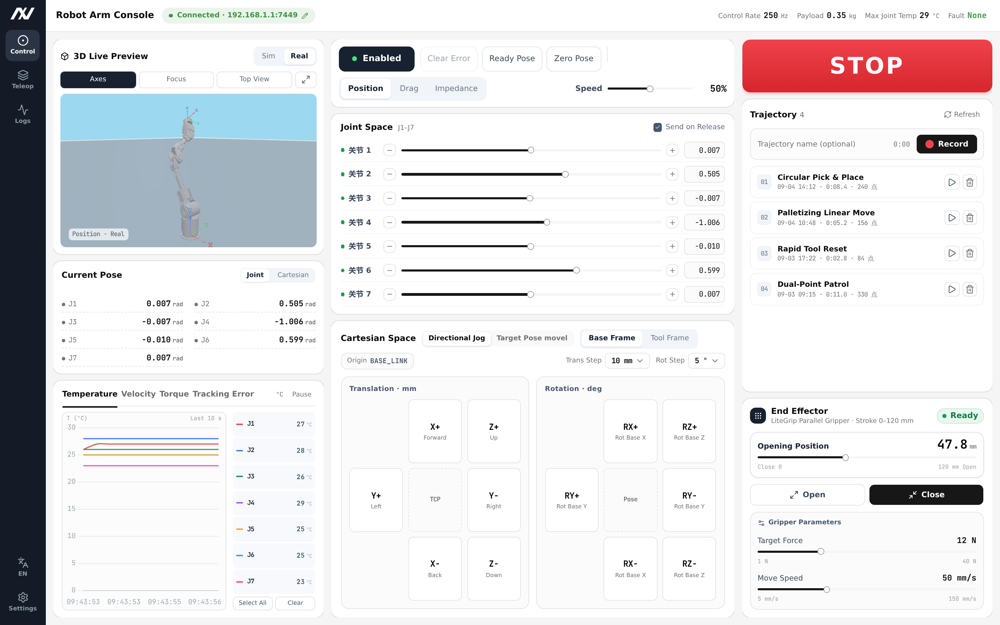

```{=latex}
\begin{titlepage}
\thispagestyle{empty}
\begin{tikzpicture}[remember picture,overlay]
  % Cover laid out absolutely; coordinates are pt from the top-left of the page, matching
  % the reference cover. Manual title centred at y≈262; logo mark from y≈108, 112pt tall.
  % The brand logo replaces the earlier LITEARM SE wordmark.
  \node[anchor=north,inner sep=0pt] at ($(current page.north west)+(298.75pt,-108.9pt)$)
      {\includegraphics[width=100pt,height=112pt,keepaspectratio]{LITEARM_SE_images/cover_litearm_logo.png}};
  \node[anchor=center] at ($(current page.north west)+(298.75pt,-262.4pt)$)
      {{\fontsize{28}{34}\selectfont\sffamily\bfseries Software Development Manual}};
  \node[anchor=north,inner sep=0pt] at ($(current page.north west)+(298.75pt,-300.8pt)$)
      {\includegraphics[width=289.1pt,height=289.1pt,keepaspectratio]{LITEARM_SE_images/cover_litearm_se.png}};
  \node[anchor=center] at ($(current page.north west)+(298.75pt,-717.8pt)$)
      {{\fontsize{11}{14}\selectfont\bfseries NEXFORM ROBOTICS}};
  \node[anchor=center] at ($(current page.north west)+(298.75pt,-747.9pt)$)
      {{\fontsize{9}{13}\selectfont Version: V1.0.4\qquad Date: October 16, 2026}};
\end{tikzpicture}
\end{titlepage}
\pagenumbering{Roman}
\thispagestyle{frontmatter}
\section*{Revision History}
```

| Version | Date | Revision |
|---|---|---|
| V1.0.4 | 2026-10-16 | Control architecture moved to the on-board control board with a direct USB link; the SDK chapter rewritten against `litearm-python`; the host application chapter condensed |
| V1.0.3 | 2026-09-03 | Updated the host application description |
| V1.0.2 | 2026-08-20 | Updated the SDK description |
| V1.0.1 | 2026-07-15 | First draft of the LITEARM SE software development manual |

```{=latex}
\clearpage
\thispagestyle{frontmatter}
\tableofcontents
\clearpage
\pagenumbering{arabic}
\makeatletter\def\fps@figure{H}\makeatother
```


# Introduction

The SDK, the host application and the companion documents all live on GitHub:

- **NEXFORM ROBOTICS organisation**: <https://github.com/nexform-tech>
- **Arm unboxing and installation guide** (unpacking checklist, desktop mounting, column stand, electrical connection): <https://github.com/nexform-tech/litearm-setup>

> This manual covers software only. Mechanical assembly and electrical connection are out of scope; get them from the installation guide above.

## What the software needs

From a software point of view, using LITEARM SE needs the following hardware and components:

| Component | Notes | What matters for development |
|---|---|---|
| Arm | LITEARM SE, 7 joints | Connects to the control board through the supplied cable |
| Control board | On-board controller, ships with the arm, runs the firmware | Carries trajectory planning, forward and inverse kinematics, dynamics and the control law; the host PC connects to it directly over USB |
| Host PC | Runs Python / C++ / ROS 2 / simulation | Needs one free USB port only — no CAN hardware, no network configuration |
| Power module | 600 W with bleed, optional | Output runs to the control board through XT60 (wiring steps are in the LITEARM-SE installation guide) |
| End effector (optional) | Gripper and so on | Driven by that product's own SDK |

The control path is `client program → USB (virtual serial port) → control board firmware → CAN (inside the board) → joints`. **All planning and control happens in the control board firmware**; the PC-side SDK only encodes and decodes frames, sends commands, and decides whether the arm has arrived. Each `Arm` session holds one serial port exclusively, so one arm can be held by one process at a time.

## Units

As in the SDK and the product manual: position in m, orientation and joint angles in rad, a speed of 1.0 meaning a normalised speed (the firmware interprets it against its own planning scale during joint motion — see "Poses, units and kinematics"), mass in kg, force and torque in N and N·m.

A pose is **six numbers**: `pose = (x, y, z, rx, ry, rz)`, the first three position in metres and the last three orientation in radians — RPY angles about the base frame's X, Y and Z axes. A list and a tuple both work, for example `(0.30, 0.0, 0.40, 3.1416, 0.0, 0.0)`. The SDK also accepts the "three position numbers plus a 3×3 rotation matrix" form; see "Poses, units and kinematics".

## Safety

### Scope

Beyond hardware safety, development raises software-side safety semantics. Anyone developing or debugging should be trained, and should understand how joint-space and Cartesian motion differ, what enable, disable and emergency stop mean, and what soft limits and collision detection do. Section 1.3 of the LITEARM SE product manual is the authority on the details.

### Warning signs

This manual and the product manual use the four warning signs below. The markings on the delivered product are the authority.

```{=latex}
\noindent\textbullet{}~\textbf{DANGER}: a hazard that will cause death or serious injury, or severe equipment damage.\par
\vspace{0.4em}\noindent\makebox[\linewidth][c]{\includegraphics[width=0.095\linewidth]{LITEARM_SE_images/safety/en/danger.png}}\par
\vspace{1em}
\noindent\textbullet{}~\textbf{WARNING}: a hazard that can cause death or serious injury, or severe equipment damage, if it is not avoided.\par
\vspace{0.4em}\noindent\makebox[\linewidth][c]{\includegraphics[width=0.095\linewidth]{LITEARM_SE_images/safety/en/warning.png}}\par
\vspace{1em}
\noindent\textbullet{}~\textbf{HIGH TEMPERATURE}: hot parts, where contact can cause burns or damage equipment.\par
\vspace{0.4em}\noindent\makebox[\linewidth][c]{\includegraphics[width=0.095\linewidth]{LITEARM_SE_images/safety/en/high_temp.png}}\par
\vspace{1em}
\noindent\textbullet{}~\textbf{NOTICE}: a general caution, where failure to avoid the hazard can cause injury or equipment damage.\par
\vspace{0.4em}\noindent\makebox[\linewidth][c]{\includegraphics[width=0.095\linewidth]{LITEARM_SE_images/safety/en/notice.png}}\par
```

### Safety notices (software side)

1. **`disable()` de-energises the motors and the arm falls under gravity.** Never call it while the arm is unsupported or someone is close. `enable()` energises the arm and holds the current pose.
2. Before any motion, make sure the emergency stop is within reach and the working area is clear. Use a conservative speed for the first motion, such as `speed=0.1` to `0.2`.
3. `home()` and zero-gravity hand-guiding (`zero_g()`) carry special semantics. `home()` requires `enable()` first, and the firmware hard-codes its speed at 0.10. Before leaving `zero_g()` you must push every joint back inside its soft limits — once a limit-overrun latch is set it is not gated by the enable state and `reset()` does not clear it.
4. Assess safety before changing `params.set_joint_limits()`, `set_payload()`, `set_gravity_vector()`, `set_gravity_scale()`, `params.set_joint_param()` or similar. A wrong payload mass or centre of mass, or a wrong gravity direction, makes compensation wrong and can cost you control of the arm.
5. High-rate direct control (`send_mit`, `send_mit_all`, `move_js`, `joint_follow`) bypasses firmware planning. It is an advanced feature for engineers with control and safety experience, and the caller **must keep it alive at 10 Hz or more**.
6. The following commands overwrite or erase that unit's dynamics calibration and are **irreversible**. Do not run them on a calibrated arm: `save_params()`, `model.commit()`, `params.reset_factory()`, `model.revert()`.
7. The firmware carries slew-rate limiting, soft limits, rejection of illegal values, the communication watchdog and the emergency stop fallback, and it **does not depend on the host PC being connected**. That is only a hard backstop, though; it does not replace parameter validation in your own program.
8. Passing in simulation does not mean the arm is safe. Moving to the real arm still needs step-by-step validation at low speed and light load.

### Responsibility

You are responsible for the safety of the complete system you build on top of the SDK, for its risk assessment and for its protective design. We accept no liability for damage caused by use outside these requirements or by events beyond our control. See section 1.3.4 of the product manual.

### Risk assessment

Alongside section 1.3.5 of the product manual, the risk assessment should cover software-triggered risks too, such as a remote command driving the arm at high speed or dropping a payload.

---

# SDK guide

## Overview

The LITEARM SE software stack is layered as **"client SDK or framework → USB → control board firmware → CAN → joints"**. **Trajectory planning, forward and inverse kinematics, dynamics and the control law all run in the control board firmware**; the PC-side SDK only encodes and decodes frames, sends commands and decides whether the arm has arrived. The Python and C++ client interfaces are semantically identical, and both ROS 2 and the simulation adapters sit on the same control path.

| Layer | Typical components | Role |
|---|---|---|
| Application | Your Python or C++ program, ROS 2 nodes, a LeRobot policy | Business logic, algorithms, trajectories or policies |
| SDK / adapter | litearm-python / litearm-cpp | State reads, motion control, parameter management |
| Firmware | Control board firmware | Planning, kinematics, dynamics, the control law and the safety backstop |
| Hardware | Control board + CAN + LITEARM SE joints | Joint actuation and state feedback |

**Connection conventions**

- Between the host PC and the control board there is **one USB cable**: a USB CDC virtual serial port at VID:PID `1d50:606f`, baud rate 921600. **No IP or network configuration is needed.**
- The port is optional — `Arm(port=None)` discovers the control board by VID:PID. You can also pass one explicitly, as in `Arm(port="/dev/ttyACM0")`. The SDK **reads no environment variables**.
- One session holds the serial port exclusively, so one arm can be held by one process at a time (see "Connecting: the minimal example").
- This chapter follows the **Python SDK (litearm-python)**. C++, ROS 2 and the simulation ecosystem are covered in "Other languages and the wider ecosystem".

## Dependencies

| Language / framework | Package | Requirements | Status |
|---|---|---|---|
| Python | litearm-python | Python ≥ 3.9; one dependency, `pyserial >= 3.4`; no CAN hardware | Main line |
| C++ | litearm-cpp | C++17, CMake ≥ 3.14; no third-party dependencies (standard library plus the platform serial API) | Available |
| ROS 2 | litearm-ros2 / litearm-ros2-control | ROS 2 Humble; the ros2_control package drives the arm through litearm-cpp | Available |
| URDF/RViz | litearm-description | Standard URDF description package, shared by RViz, MoveIt 2 and the simulations | Available |
| MoveIt 2 | litearm-moveit2 | ROS 2 Humble + MoveIt 2 | Available |
| MuJoCo | litearm-mujoco | Installed with pip; `MujocoArm` simulation interface | Available |
| PyBullet | litearm-pybullet | Installed with pip; `PyBulletArm`, aligned with litearm-python | Available |
| Isaac Sim | litearm-isaacsim | NVIDIA Isaac Sim simulation environment | Available |
| LeRobot | litearm-lerobot | litearm-python; LeRobot dataset recording and policy adapters | Available |
| Host application | litearm-studio | Python 3.10+; graphical console | Available |

> The control board firmware must be `Litearm1.5.0` or later. A version string looks like `Litearm1.5.0-7J` — `Litearm`, three version fields, then `-7J` for seven axes or `-1J` for a single-axis bench. `connect()` refuses outright when the version is too low or the string does not follow that convention.

## Installing and using the Python package (main line)

### Install

```bash
git clone https://github.com/nexform-tech/litearm-python.git
cd litearm-python
pip install -e .                  # installs (pin the version for a real deployment)
python3 -c "import litearm; print(litearm.__version__)"   # verify
```

The install also provides the `litearm-python` command-line entry point (equivalently `python -m litearm`); see "Read-only attributes and the command line".

### Requirements and environment

- Python: **3.9 or later**.
- Dependencies: **`pyserial >= 3.4`, and nothing else**. No numpy, no CAN hardware, no middleware.
- Driver and permissions: on Linux add your user to the serial group and log back in for it to take effect:

```bash
sudo usermod -aG dialout $USER
```

- Windows, Linux and macOS are all supported.

### Connecting: the minimal example

```python
import litearm as pa

with pa.Arm().connect() as arm:          # no port given: the control board is discovered by VID:PID
    print(arm.firmware, arm.n)           # firmware version string, joint count
    state = arm.get_state().value        # reads go through .value, see "Reading values"
    print(state.q, state.dq, state.tau)  # joint angles / velocities / torques
    print(arm.get_tcp().value)           # current tool pose (six numbers)
```

Points to note:

- **`Arm().connect()` is the only entry point.** By the time `connect()` returns the handshake is done, so `arm.n` and `arm.firmware` are always available.
- `Arm` is a context manager (`with`), and leaving the block calls `close()`. You can also connect by hand and call `arm.close()`. **Each session owns a background reader thread, so it must be closed.**
- To pass a port explicitly (several devices, or discovery failed): `pa.Arm(port="/dev/ttyACM0").connect()`.

### Reading values: the `Msg` envelope and `RobotState`

The eleven "read one frame" calls return a `Msg` envelope, and **the data itself is in `.value`** — printing `Msg` shows the envelope, not the state.

```python
@dataclass(frozen=True)
class Msg(Generic[T]):
    value: T          # the return value itself (None when no frame was available)
    hz: float         # average arrival rate of this frame type in this session
    timestamp: float  # local time of the most recent frame (0.0 if none ever arrived)

print(arm.get_state())            # Msg(value=RobotState(...), hz=100.2, timestamp=...)
print(arm.get_state().value.q)    # [0.0, 0.0, 0.0, 0.0, 0.0, 0.0, 0.0]
```

- `get_state()` consumes the state frames the control board pushes continuously, about 100 Hz, at no round-trip cost.
- `get_status_now()` **sends a query** instead, so you can use it to confirm the link is alive. It raises `MotionTimeoutError` when no frame has arrived yet in this session.
- **`hz == 0.0` together with `timestamp == 0.0` means this frame type never arrived**, not that the link is slow.

The main `RobotState` fields and derived attributes:

| Field / attribute | Notes |
|---|---|
| `mode` / `mode_name` | Current mode and its name |
| `flags` / `flag_names` | Status bits and their names |
| `seq` | Arrival sequence number of the state frame, for telling whether the stream is still moving |
| `joints` | `list[JointState]`, each with `q` / `dq` / `tau` / `t_mos` / `t_coil` / `err` |
| `joint_fault` | Per-axis dropout bitmap |
| `n` / `enabled` / `cart_busy` | Joint count / enabled / Cartesian motion in progress |
| `q` / `dq` / `tau` | Joint angles (rad), velocities (rad/s), torques (N·m) |
| `fault_axes` / `faulted` / `fault_detail` | Faulting axes and the fault details |

### Motion control (joint and Cartesian)

```python
import litearm as pa

with pa.Arm().connect() as arm:
    arm.enable()                                    # enable first, always, before motion

    # Joint space: q is seven joint angles in rad; the firmware plans an S-curve and completes it
    arm.movej([0.0, 0.0, 0.0, 0.0, 0.0, 0.0, 0.0], speed=0.2)
    arm.movej_sync([0.3, 0.0, 0.0, 0.0, 0.0, 0.0, 0.0], speed=0.2)   # all axes arrive together

    # Cartesian line: a pose is six numbers (three position + three RPY)
    P1 = (0.30, 0.0, 0.40, 3.1416, 0.0, 0.0)
    P2 = (0.32, 0.0, 0.42, 3.1416, 0.0, 0.0)
    P3 = (0.34, 0.0, 0.44, 3.1416, 0.0, 0.0)
    arm.move_l(P2, speed=0.5)                       # straight line
    arm.move_path([P1, P2, P3], speed=0.5)          # through the waypoints in order (sharp corners)
    arm.move_c(arm.get_tcp().value, P2, P3)         # circular arc (start must be the measured TCP)

    arm.home()                                      # return to the home pose
```

| Call | What the tool does / notes |
|---|---|
| `movej(q, speed=1.0)` | One-shot joint-space move; the firmware plans an S-curve and completes it, then holds still. **Joint limits are not checked**, and an out-of-range target is truncated by the firmware before the arm runs the full travel |
| `movej_sync(q, speed=1.0)` | Synchronised joint-space point to point, all axes arriving together |
| `home(*, timeout=None)` | Return to the home pose. **Requires `enable()` first**; the firmware hard-codes the speed at 0.10 and takes no `speed` argument (`arm.home(speed=0.3)` raises `TypeError`) |
| `move_js(q, dq=None, tau_ff=None)` | Low-level joint stream, bypassing planning; the caller must resend at 10 Hz or more (see "Passthrough and servoing") |
| `move_p(pose, speed=1.0, pos_tol=0.006, rpy_tol=0.03)` | Point to point interpolated in joint space, so **the tool does not travel in a straight line**; takes a single pose |
| `move_l(pose, speed=1.0, wait=True)` | Cartesian straight line (linear position, spherical orientation interpolation) |
| `move_c(pose_start, pose_via, pose_goal, speed=1.0, wait=True)` | Circular arc (three points define the circle; the orientation of `via` is ignored). `start` must match the measured TCP at the time of the call |
| `move_path(poses, speed=1.0, wait=True)` | Through several waypoints in order; **the corners are sharp** (no blending) |
| `poll_cart()` | The claimable queue of Cartesian progress updates (used with `wait=False`) |
| `set_speed(percent)` | A global, **persistent** speed override. `percent` is an **integer percentage from 0 to 100** — `set_speed(1)` means 1% speed, not full speed |

> `movej` / `movej_sync` / `move_p` / `home` return `RobotState`; `move_l` / `move_c` / `move_path` return `CartPlan`. `speed` is a normalised 0 to 1 ratio (`set_speed` excepted). A rejected Cartesian plan raises `CartesianPlanError`, and **the whole path is refused — the arm does not move a step**.
>
> **`movej` returning does not mean the arm has settled**: the residual is about 0.012 rad, inside the arrival tolerance. When you need a precise stop, add your own settling delay or read the state to confirm.

### Poses, units and kinematics

- **Pose format**: `pose = (x, y, z, rx, ry, rz)`, the first three position in metres and the last three orientation in radians — RPY angles about the base frame's X, Y and Z axes. A list and a tuple both work. **These are not a rotation matrix and not a quaternion.**
- The SDK also accepts the "three position numbers plus a 3×3 rotation matrix" form:

```python
arm.move_p(([0.30, 0.0, 0.35], [[1, 0, 0], [0, 1, 0], [0, 0, 1]]))
```

- **Inverse kinematics**: `ik(pose, q_seed=None, timeout=3.0) -> list[float]`, raising `IKError` on failure. It may return a different but equally valid branch; a result far from `q_seed` is not necessarily wrong.

```python
q = arm.ik((0.30, 0.0, 0.35, 3.1416, 0.0, 0.0))
```

- **There is no `fk(q)`**: the PC side carries no kinematic model, because only the firmware can do forward kinematics. To read the current tool pose, use `get_tcp()`.

### Life safety and state control

| Function | Call | Notes |
|---|---|---|
| Enable | `enable(attempts=12)` | Energises every joint and holds the current pose; a retry only helps for the codes on the firmware's retryable whitelist |
| Disable | `disable()` | Cuts the position loop. **The arm is no longer held up and falls under gravity** |
| Emergency stop | `emergency_stop()` | A single frame, one way, reading no state. **The only entry point with no preconditions** |
| Reset | `reset()` | Clears faults and re-anchors the control loop. **It is not an MCU reboot**, and the same object stays usable |
| Clear faults | `clear_faults()` | Clears RAM fault bits only; writes no Flash |
| Mode | `set_motion_mode(mode)` / `park()` | The firmware accepts `0` only, and any other value raises `InvalidCommandError` locally. `park()` is `set_motion_mode(0)` |
| Zero gravity | `zero_g()` | A context manager for free movement under gravity compensation (hand-guiding); see "Hand-guiding (zero gravity)" |

### Parameters and feed-forward tuning

| Function | Call | Notes |
|---|---|---|
| Payload | `set_payload(mass, com=(0.0, 0.0, 0.0))` | Tool payload mass (kg) and centre of mass. **Correct compensation depends on this**, so re-set it whenever the payload changes |
| Gravity direction | `set_gravity_vector(g)` | The mounting orientation (upright, side or inverted) is expressed through the gravity direction |
| Gravity feed-forward | `set_gravity_scale(gs)` / `set_inertia_scale(isc)` | Scale gravity and inertia feed-forward joint by joint; the length must equal the joint count |
| Feed-forward mask | `set_ff_mask(mask)` / `get_ff_mask()` / `ff_preset(preset)` | `preset`: 0 all off / 1 factory / 2 all on |
| Feed-forward vectors and scalars | `set_ff_vec(item, values)` / `set_ff_scalar(item, sub, value)` / `get_ff_vec(item)` / `get_ff_scalar(item, sub=0)` | Reads and writes dynamics and control-law parameters (`item` and `sub` follow the firmware parameter table) |
| Joint parameters | `arm.params.set_joint_param(idx, kp, kd, tau_max)` / `get_joint_param(idx)` / `all_joint_params()` | Per-joint kp, kd and torque ceiling; assess safety before changing them |
| Joint limits | `arm.params.set_joint_limits(idx, q_min, q_max)` | Soft limits. **They only narrow**, and writing back the current value is treated as a request to widen and rejected |

> Everything above writes RAM. To keep it across a power cycle, call `save_params()` to write Flash, which is **irreversible**.

### Hand-guiding (zero gravity)

```python
arm.enable()                        # must already be enabled before entering
with arm.zero_g():
    input("Move the arm by hand, then press Enter")
```

- `zero_g()` is a context manager built from `zero_g_start()` and `zero_g_stop()`. Once entered, the firmware uses virtual springs and damping to make the arm feel soft, so you can hand-guide it.
- The SDK's background thread keeps it alive by resending at `period` (0.04 s by default, which must lie in `[0.005, 0.10)`), so the caller does not have to.
- While that keep-alive runs, other **motion** commands are refused. Emergency stop and disable are the exceptions, and queries are unrestricted.
- **Before leaving, push every joint back inside its soft limits.** Zero gravity skips the position limit latch, but as soon as you leave, that latch takes effect, is not gated by the enable state, and `reset()` does not clear it.
- Leaving is asynchronous: after `zero_g_stop()` returns, the firmware still needs a moment to finish. The read-only `zero_g_active` and `zero_g_error` attributes report the state.

### Passthrough and servoing

These bypass firmware planning and drive the joints frame by frame with MIT parameters. **The caller must keep the stream alive, resending at 10 Hz or more**, otherwise the 0.1 s watchdog drops into fail-soft (reduced stiffness, torque zeroed) and the arm slowly sags under gravity.

| Call | Notes |
|---|---|
| `send_mit(idx, q, dq, kp, kd, tau)` | Per-frame direct control of one joint with the five MIT parameters |
| `send_mit_all(q, dq, kp, kd, tau)` | All joints; all five arrays must match the joint count and hold finite numbers |
| `joint_follow(q, dq, kp, kd)` | `send_mit_all` without feed-forward in the frame; the firmware computes feed-forward itself each tick, saving the follow loop a round trip |
| `move_js(q, dq=None, tau_ff=None)` | Low-level joint stream; `dq` is a velocity reference, not a rate ceiling |

> This group has not been fully validated on real hardware; use it with care. Any other motion or stop command ends the current passthrough session.

### Joint parameters, dynamics model, data capture and firmware self-test

Four sub-namespace objects, all attributes of `arm.`:

| Object | Main calls | Purpose |
|---|---|---|
| `arm.params` | `set_joint_param(idx, kp, kd, tau_max)`, `set_joint_limits(idx, q_min, q_max)`, `get_joint_param(idx)`, `all_joint_params()`, `reset_factory()` | Joint-level parameters (kp, kd, torque ceiling, soft limits) |
| `arm.model` | `probe()`, `get_body(idx)`, `set_body(idx, vals)`, `get_gravity(q)`, `status()`, `commit(expected_mask)`, `revert()` | Online import and rollback of the dynamics model |
| `arm.log` | `start(n_ticks)`, `stop()`, `reader()`, `capture(n_ticks)`, `dump(path)` | 300 Hz control-tick capture (`LOG_MAX_SAMPLES = 2400`, filling up in about 8 s and stopping itself) |
| `arm.diag` | `kin_bench()` | Firmware self-test and CAN link diagnostic counters |

```python
for jp in arm.params.all_joint_params():
    print(jp.idx, jp.kp, jp.q_min, jp.q_max)

arm.log.start(300)                  # capture 300 ticks, then stop automatically
r = arm.log.reader()
for s in r.samples()[:3]:
    print(s.tick, s.q_ref, s.dq, s.tau)
```

> `arm.params.set_joint_limits()` **only narrows** and is not idempotent, so do not use it as a read-modify-write loop. `arm.model.set_jm()` (changing the joint mapping) should never be called: getting it wrong can send the arm flying, and the only way back on that unit is itself irreversible.

### Licensing, firmware upgrade and parameter persistence

| Call | Notes |
|---|---|
| `license(timeout=1.0)` | Reads the licence record (returns a bare `LicenseInfo`, not a `Msg`) |
| `activate(*, cust_id, issued, flags=0, mac, timeout=2.0)` | Submits the vendor-issued credential. **Requires `disable()` first** |
| `enter_dfu(timeout=0.3)` | Enters the ROM bootloader without a probe, for flashing firmware. **The one terminal-state operation** |
| `save_params()` | Writes the current RAM parameters to Flash. **Irreversible** |

- The device is locked at the factory, and **`enable()` is refused on an unactivated arm** (other commands still work, so you can diagnose on site). The activation record is **written once and never erased**.
- After `enter_dfu()` this `Arm` object must not be used again (every entry point raises `ArmIsInDfuError`, `close()` excepted). The device re-enumerates as `0483:DF11`, so wait for USB re-enumeration before flashing, and construct a new `Arm` afterwards.

### Read-only attributes and the command line

```python
print(arm.n, arm.firmware, arm.fw_version)      # joint count / version string / version tuple
print(arm.q_tol, arm.dq_tol, arm.move_timeout)  # arrival criteria and motion timeout
print(arm.zero_g_active, arm.last_reset_reason)
```

The `litearm-python` command-line entry point (equivalently `python -m litearm`):

```bash
litearm-python status                          # read-only
litearm-python fw                              # version string and axis count
litearm-python tcp                             # current pose and frame rate
litearm-python movej -0.1 0 0 0 0 0 0 --speed 0.3
litearm-python home
```

> `status`, `fw` and `tcp` are read-only; the rest really drive the arm. The number of `movej` targets must equal `arm.n` exactly.

### Core API at a glance

| Category | Calls |
|---|---|
| Connection | `Arm(port=None)`, `connect()`, `close()`, `disconnect()`, `reconnect()` |
| State | `get_state()`, `get_status_now()`, `get_tcp()` |
| Kinematics | `ik(pose, q_seed=None)` (no `fk()`) |
| Motion | `movej()`, `movej_sync()`, `home()`, `move_p()`, `move_l()`, `move_c()`, `move_path()`, `poll_cart()`, `set_speed()` |
| Safety | `enable()`, `disable()`, `emergency_stop()`, `reset()`, `clear_faults()`, `set_motion_mode()`, `park()` |
| Hand-guiding | `zero_g()`, `zero_g_start()`, `zero_g_stop()` |
| Passthrough | `move_js()`, `send_mit()`, `send_mit_all()`, `joint_follow()` |
| Feed-forward / dynamics | `ff_preset()`, `set_ff_mask()`, `get_ff_mask()`, `set/get_ff_vec()`, `set/get_ff_scalar()`, `set_gravity_vector()`, `set_gravity_scale()`, `set_inertia_scale()`, `set_payload()` |
| Joint parameters | `arm.params.*` |
| Dynamics model | `arm.model.*` |
| Data capture | `arm.log.*` |
| Firmware self-test | `arm.diag.kin_bench()` |
| Licence / firmware | `license()`, `activate()`, `enter_dfu()`, `save_params()` |

### Exceptions and error handling

Every exception derives from `LiteArmError`. A command the firmware rejects outright raises `CommandRejectedError`, carrying the `.cmd` and `.code` fields.

```python
from litearm import (
    LiteArmError, NotConnectedError, TransportError, FirmwareMismatchError,
    InvalidCommandError, MotorFaultError, MotionTimeoutError, IKError,
    CommandRejectedError, UnsupportedByFirmwareError, CartesianPlanError,
)

try:
    arm.movej([0.0]*7, speed=0.5)
except MotorFaultError as e:
    print("motor fault:", e)              # a state frame carries FAULT or EMERGENCY
    arm.reset()                           # clear faults and re-anchor the control loop
except IKError as e:
    print("ik failed:", e)                # no inverse solution / target unreachable
except CartesianPlanError as e:
    print("cartesian plan failed:", e)    # a plan the firmware refused (no solution / collinear / over capacity)
except CommandRejectedError as e:
    print("rejected:", e.cmd, e.code)     # the firmware replied ERR{cmd, code}
```

> `except InvalidCommandError` does **not** cover `CartesianPlanError`: the latter hangs directly off `LiteArmError`, because it reports the firmware's verdict on a trajectory rather than a rejected command. Among the error codes, `code == 0x00` always means the firmware does not have that command (`UnsupportedByFirmwareError`).

## Other languages and the wider ecosystem

There is exactly one control path into LITEARM SE: **the host PC connected directly to the control board over USB**. Every official SDK is a different language wrapper around that path, and planning, kinematics and dynamics always happen in the control board firmware while the host only sends targets, reads state back and decides whether the arm has arrived.

### C++ SDK (litearm-cpp)

A C++ port of `litearm-python` 2.1.0: the same wire protocol, the same semantics and the same safety criteria, line for line.

| Item | Requirement |
|---|---|
| Compiler | C++17 (g++ 7+ / clang 6+ / MSVC 2019+) |
| Build | CMake ≥ 3.14 |
| Third-party dependencies | **None** — only the C++ standard library and the platform serial API (POSIX termios / Win32) |
| Firmware | `Litearm1.5.0` or later |
| Connection | USB CDC serial, discovered automatically by `VID:PID 1d50:606f` |

```cpp
#include <litearm/litearm.hpp>

int main() {
    litearm::Arm arm;                 // no port: discovered by VID:PID 1d50:606f
    arm.connect();
    arm.movej({0.0, 0.0, 0.0, 0.0, 0.0, 0.0, 0.0}, 0.2);
    arm.close();
    return 0;
}
```

The namespace is `litearm`, the class is `litearm::Arm`, the headers live in `include/litearm/`, and the build produces a single static library, `liblitearm.a`.

### ROS 2

Two **mutually exclusive** entry points, both connected directly to the control board, neither running a daemon, and both opening the serial port through `litearm-cpp`:

| Repository | Role |
|---|---|
| `litearm-ros2-control` | A ros2_control `SystemInterface` plugin driven by `joint_trajectory_controller` or MoveIt 2, for motion control |
| `litearm-ros2` | A separately maintained driver node (a lifecycle node with 55 services), for acceptance testing, licensing and parameter debugging outside the control loop |

> **The two must never run at the same time.** They open the same USB CDC serial port, the SDK takes an exclusive `flock` on it, and the second process simply cannot open it.

`litearm-description` provides the URDF description of each model (SE under `SE/litearm_description/`), and `litearm-moveit2` provides the MoveIt 2 configuration package `litearm_moveit_config`. The next section gives the launch steps.

### Simulation and embodied AI

| Repository | Status |
|---|---|
| `litearm-pybullet` | **Aligned 1:1** with `litearm-python`: the same 31 method names, arguments and defaults, returning the same `Msg` / `RobotState` / `CartPlan`, with poses as six numbers |
| `litearm-mujoco` | Used the same way as `litearm-python`, but still written against the older interface: `movel` / `get_tcp_pose()` and the "three position numbers plus a 3×3 rotation matrix" pose, not yet migrated |
| `litearm-isaacsim` | Three nodes in one-way sync: an API command is published, the real arm executes it, and Isaac Sim follows the **measured** joint angles, so motion produced any other way (hand-guiding included) is followed too |
| `litearm-lerobot` | A LeRobot `Robot` adapter: `observation.state` is the seven absolute joint angles and `action` is the seven joint targets, so a `LeRobotDataset` can be recorded |

```python
from litearm_pybullet import PyBulletArm

with PyBulletArm(render=True) as arm:            # connect() is implicit
    arm.movej([0.0, 0.6, 0.0, -1.2, 0.0, 0.7, 0.0], speed=0.2)
    x, y, z, r, p, yw = arm.get_tcp().value      # six numbers, not a rotation matrix
    arm.move_l([x, y, z - 0.1, r, p, yw], speed=0.1)
```

### Repository reference

| Component | Repository |
|---|---|
| Python SDK | https://github.com/nexform-tech/litearm-python |
| C++ SDK | https://github.com/nexform-tech/litearm-cpp |
| ROS 2 control stack | https://github.com/nexform-tech/litearm-ros2-control |
| ROS 2 maintenance driver | https://github.com/nexform-tech/litearm-ros2 |
| URDF description | https://github.com/nexform-tech/litearm-description |
| MoveIt 2 | https://github.com/nexform-tech/litearm-moveit2 |
| Host application | https://github.com/nexform-tech/litearm-studio |
| Installation guide | https://github.com/nexform-tech/litearm-setup |
| MuJoCo | https://github.com/nexform-tech/litearm-mujoco |
| PyBullet | https://github.com/nexform-tech/litearm-pybullet |
| Isaac Sim | https://github.com/nexform-tech/litearm-isaacsim |
| LeRobot | https://github.com/nexform-tech/litearm-lerobot |

## Using the ROS 2 environment

On the ROS 2 side there is **no Python bridge process**: the ros2_control plugin holds the arm's USB CDC link itself, goes through `litearm-cpp`, takes the state frames the SDK has already cached in `read()`, and sends command references back with the firmware's `MOVE_JS` servo in `write()`. Planning, kinematics and dynamics stay in the firmware.

### Environment and preparation

| Item | Requirement |
|---|---|
| ROS 2 | Humble |
| Build | `ament_cmake`, C++17 |
| SDK | `litearm-cpp`, installed or present as a sibling source tree |
| Firmware | `Litearm1.5.0` or later |
| Connection | USB CDC serial, `VID:PID 1d50:606f` |
| Serial permissions | On Linux, `sudo usermod -aG dialout $USER`, taking effect after you log back in |

Firmware older than 1.5.0 is refused at connection time: the control stack relies on the state frame layout, the `joint_fault` field and the enable bit that only 1.5.0 introduced.

The workspace layout is below (keep exactly one copy of the arm description in a workspace):

```text
~/litearm_ws/src/
├── litearm-cpp/              # C++ SDK
├── litearm-description/      # URDF description (package name litearm_description)
└── litearm-ros2-control/     # ros2_control plugin
```

```bash
source /opt/ros/humble/setup.bash
cd ~/litearm_ws
colcon build
source install/setup.bash

lsusb | grep 1d50              # should show 1d50:606f
ls /dev/ttyACM*                # should show /dev/ttyACM0
```

### Launching the control stack

```bash
ros2 launch litearm_ros2_control litearm_control.launch.py
```

| Argument | Default | Meaning |
|---|---|---|
| `port` | `''` | USB CDC path. Left empty, the board is discovered by `1d50:606f`; with several boards, pass `port:=/dev/ttyACM1` |
| `clear_faults` | `true` | Clears latched faults once during configuration, so "after a fault" is still a single command; `false` lets a latched fault block startup |
| `start_joint_state_broadcaster` | `true` | Starts and activates `joint_state_broadcaster` |
| `start_joint_trajectory_controller` | `true` | Starts and activates `joint_trajectory_controller` |
| `ros_domain_id` | `42` | This stack's ROS domain, deliberately away from 0 |
| `ros_localhost_only` | `true` | Local discovery only, so a second arm on the same subnet does not turn up in RViz |

Once the stack is up the arm is an ordinary ros2_control system: send trajectories to `arm_controller` (a `joint_trajectory_controller`), or plan in MoveIt 2 and let `move_group` execute. The joint names are `joint1` through `joint7`.

**Control stack + MoveIt 2 + RViz2** (one command that includes the one above):

```bash
ros2 launch litearm_moveit_config litearm_moveit.launch.py
ros2 launch litearm_moveit_config litearm_moveit.launch.py use_rviz:=false       # headless
ros2 launch litearm_moveit_config litearm_moveit.launch.py start_control:=false  # move_group only
```

Both launches pin the domain to 42 and turn on local-only discovery, so to observe from another terminal you must export the same variables first:

```bash
export ROS_DOMAIN_ID=42; export ROS_LOCALHOST_ONLY=1
ros2 node list
```

### Interface mapping

Each joint exports three state interfaces and two command interfaces:

| Direction | Interface | Firmware meaning |
|---|---|---|
| command | `position` | `q_ref` (sent through `MOVE_JS`) |
| command | `velocity` | `dq_ref` |
| state | `position` | measured `q` |
| state | `velocity` | measured `dq` |
| state | `effort` | measured `tau` — a current estimate, noisy, and **not usable for control** |

With `export_diagnostic_interfaces` set to `true` (the default), each joint also exports four diagnostic state interfaces:

| Interface | Meaning |
|---|---|
| `temperature_mos` | MOSFET temperature |
| `temperature_coil` | Coil temperature |
| `error_code` | Firmware fault word |
| `feedback_age` | Age of the most recent state frame, in seconds |

> **Command watchdog**: the firmware trips when it sees no command for 100 ms, so `write()` must keep resending, which any controller manager update rate of 100 Hz or more satisfies automatically. While the control loop is active, do not let it stall for more than about 100 ms — after that the firmware falls back to fail-soft and the arm sags in the direction the payload pulls it.
>
> Be clear about the trade-off of driving the arm in-process, too: `write()` enters the SDK, writes a frame and waits for the firmware ACK, bounded by the SDK's own 1.2 s timeout. On a healthy link that is sub-millisecond; on a stuck USB link it can block the control loop for that whole timeout. This plugin offers no hard real-time guarantee.

### Maintenance driver and RViz

When you need acceptance testing, licensing and parameter debugging without a `controller_manager`, use the maintenance driver:

```bash
ros2 launch litearm_driver litearm_driver.launch.py
ros2 service call /litearm/get_status litearm_msgs/srv/GetStatus "{}"
ros2 service call /litearm/get_tcp litearm_msgs/srv/GetTcp "{}"
```

The maintenance driver isolates the parameter gate itself: while `allow_motion` is unset, every service that would energise the motors is refused, so bad parameters are stopped **before** they reach the arm. It is mutually exclusive with the control stack above; only one can run at a time.

To look at the model without a real arm, use the URDF description package:

```bash
cd ~/litearm_ws/src/litearm-description/SE
colcon build --packages-select litearm_description
source install/setup.bash
ros2 launch litearm_description display.launch.py
```

RViz2 opens and shows the arm, with a slider per joint in the joint state GUI. The kinematic chain is `base_link → Link1 … → Link7 → ee_frame_link`, and the meshes are the STL files under `meshes/`.

## FAQ and support

### Q&A

**Q: How does joint-space motion differ from Cartesian motion?**
A: Joint-space motion (`movej` / `movej_sync`) only cares about each joint going from its current value to the target, and does not promise a straight line for the tool. Cartesian motion cares about the tool's path through space: `move_l` guarantees a straight line, `move_c` a circular arc, and `move_path` a multi-waypoint path. Both are planned in the control board firmware.

**Q: What do the elements of a joint array and a pose array mean?**
A: Joint angles `q` are `[J1, J2, …, J7]` in rad. A pose is **six numbers**, `(x, y, z, rx, ry, rz)`: position in m, orientation as RPY angles about the base frame's X, Y and Z axes in rad. The SDK also accepts the "three position numbers plus a 3×3 rotation matrix" form.

**Q: `movej` returned successfully but the arm does not move.**
A: Read the state first and check whether the arm is disabled or has a latched fault: `arm.get_state().value.enabled` and `.faulted`. When it is not enabled, call `enable()`; with a latched fault, call `reset()` (clear faults and re-anchor the control loop) before enabling. Note also that `movej` returning only means the command was accepted — it returns once the residual is about 0.012 rad, inside the arrival tolerance. For a precise stop, read the state or add a settling delay.

**Q: The arm will not connect. What should I check?**
A: In order: whether `lsusb | grep 1d50` shows `1d50:606f` (if not, check the cable and the power); whether `ls /dev/ttyACM*` shows a device (in DFU the device enumerates as `0483:DF11`); whether your user is in the `dialout` group on Linux; whether another process holds the serial port (one port can be held by one process at a time; `fuser -v /dev/ttyACM0` shows the holder); and whether the firmware is at least `Litearm1.5.0`.

**Q: The port number changed after I switched computers or replugged the cable.**
A: After re-enumeration the device can move from `/dev/ttyACM0` to `/dev/ttyACM1`. Discovering it by `VID:PID 1d50:606f` avoids the problem entirely (`Arm()` with no port, and the launch `port` left empty). When you must hard-code a path, use the stable name under `/dev/serial/by-id/` rather than a `ttyACM` number.

**Q: `/joint_states` does not appear in ROS.**
A: Confirm that `joint_state_broadcaster` is active and the arm is not in a fault state, and that the observing terminal is in the same ROS domain as the launch (`ROS_DOMAIN_ID=42`, `ROS_LOCALHOST_ONLY=1`).

**Q: Can the ros2_control stack and the maintenance driver run at the same time?**
A: No. They open the same USB CDC serial port, the SDK takes an exclusive `flock` on it, and the second process simply fails to open it. Run one at a time, and make sure the old process has exited before switching.

**Q: How do I reach technical support?**
A: The NEXFORM ROBOTICS engineering team, or GitHub Issues at [github.com/nexform-tech](https://github.com/nexform-tech).

---

# The LiteArm Studio host application

> This chapter is an overview. The full interface description, the operating steps and the troubleshooting table are a separate document, the LiteArm Studio operator manual.

## What it is and how it runs

LiteArm Studio is a graphical console for LITEARM seven-axis (J1 to J7) collaborative arms. It **needs no background service host**: the UI is a browser page served by a local Python daemon, `litearm-studio-daemon`, and that daemon is the **only** process that touches the hardware.

```text
browser window (React UI)
   │  HTTP → static assets, /api/health
   │  WS   → state downstream / commands upstream
   ▼
litearm-studio-daemon (Python, bound to the loopback address only)
   ▼
litearm-python ──USB CDC (1d50:606f)──> control board ──CAN (inside the board)──> joints
```

- **The daemon holds the arm exclusively**: it discovers the USB CDC device automatically (or takes `--port`) and pushes normalised state at 50 Hz from the frames the SDK has cached, serialising every SDK call on a single-threaded executor.
- **Emergency stop and disable use a separate channel**, so they stay reachable while a motion is running and are never blocked by it.
- **The daemon serves the UI too**: it provides the built front-end assets and opens them in a Chromium `--app=` window (falling back to an ordinary tab). Closing that window does **not** end the arm session.
- **It binds the loopback address only**: binding anything else is refused in code. Exposing an interface that can drive the arm to the local network is treated as an incident, not as a setting.

### Starting it

```bash
cd litearm-studio
pip install -e ../litearm-python
pip install -e "daemon[test]"     # installs fastapi/uvicorn and the litearm-studio-daemon entry point
pnpm install && pnpm build        # builds the UI the daemon will serve

litearm-studio-daemon --fake      # offline: runs entirely on the SDK's fake transport, no hardware needed
# litearm-studio-daemon           # real arm: discovers the USB CDC device automatically
# litearm-studio-daemon --port /dev/ttyACM1 --http-port 9000 --no-open
```

The console prints the address it actually bound (default `http://127.0.0.1:8765/`, incrementing when that is taken) and opens the window.

Each release also ships single-file executables for Windows and Linux (`litearm-studio-<version>-<platform>`) with a matching `.sha256`. They bundle the daemon, the `litearm` SDK and the built UI, so the target machine **needs no Python, no pnpm and no checkout**:

```bash
./litearm-studio-0.5.0-linux-amd64 --fake     # offline, no hardware
./litearm-studio-0.5.0-linux-amd64            # real arm, discovers USB automatically
```

### What it covers

| Module | Capability |
|---|---|
| Single-arm motion control | A real-time 3D digital twin from the URDF, with frame helpers; J1 to J7 joint sliders (ranged from the firmware soft limits) and bulk send; Cartesian jogging in the base and tool frames, plus straight-line motion to a target pose; ready pose, firmware homing, zero-gravity hand-guiding, enable / disable, fault clearing; and a high-priority STOP that stays reachable during motion |
| Telemetry | 10 Hz joint sampling (angle, velocity, torque, temperature, driver error code); browser-side IndexedDB session recording with a configurable quota between 10 and 500 MB, and CSV export |
| Localisation | English / Simplified Chinese |



> **Not in this release**: trajectory teaching and playback, a control service log page, gripper and dexterous hand panels, and per-joint impedance or hold modes. The settings and calibration pages (payload, gains, limits, self-test) are not wired to the daemon yet either — the commands exist on the daemon side, there is just no UI entry point.

## Safe operation on real hardware, and development advice

- Before enabling, moving or sending parameters to a real arm, confirm that **nobody is inside the working radius and nothing obstructs it**. The safety semantics of enable and disable, and of Home and Zero, are in the relevant chapters of the product manual.
- **Disabling releases the motors' holding torque and the arm can drop under gravity.** Before disabling, support the arm or leave it in a low, safe pose.
- The daemon and the SDK open the same USB CDC serial port, and the SDK takes an exclusive `flock` on it: **while the host application is running, no other process (an SDK script, a ROS 2 stack, the maintenance driver) can open that port**, and the reverse holds too. Never let the host application and an SDK compete for the same arm.
- For programmatic, repeatable automation, use the SDK directly (chapter 2). The host application suits manual monitoring, teaching and demonstrations.


---

# Appendix A: arm state and errors

## State fields (`RobotState`)

`arm.get_state()` returns a `Msg` envelope whose payload is a `RobotState`:

| Field | Meaning |
|---|---|
| `mode` / `mode_name` | Controller mode code and its name (such as `INIT`) |
| `flags` / `flag_names` | Configuration bitmap and the decoded name list (enabled, Cartesian motion in progress, fault, and so on) |
| `seq` | State frame sequence number; an unchanged `seq` across two frames means the read path is stuck |
| `joints` | List of `JointState`; the per-axis fields are in the next table |
| `joint_fault` | Firmware per-joint fault-degradation bitmap (reported from `Litearm1.5.0`; always 0 on the older layout) |

Derived attributes, so you do not have to compute them:

| Attribute | Meaning |
|---|---|
| `n` | Joint count (7 for the arm, 1 for the bench) |
| `enabled` | Whether the arm is enabled |
| `cart_busy` | Whether Cartesian motion is in progress |
| `q` / `dq` / `tau` | Array views of joint position, velocity and torque |
| `fault_axes` | List of faulting axis numbers |
| `faulted` | Whether the arm is in a fault state |
| `fault_detail` | A readable description of the fault |
| `drop_hold_inferred` | Whether a dropout rigid-hold latch is **inferred** to be set |

The per-axis `JointState` fields: `q` (position, rad), `dq` (velocity, rad/s), `tau` (torque, N·m), `t_mos` (MOSFET temperature, °C), `t_coil` (coil temperature, °C), `err` (that axis's driver fault code).

> **A common trap**: the `drop_hold` latch **cannot be read** — the state frame has no bit for it, so it can only be inferred. The one moment the SDK can confirm it is when a motion command behind that gate comes back `ERR{cmd, 0x06}` (see the next section).

## Python exception types

All derive from `litearm.errors.LiteArmError` and are importable from the top-level package:

| Exception | Meaning |
|---|---|
| `LiteArmError` | Base class for every SDK runtime error |
| `NotConnectedError` | Called while not connected, or with the serial port closed |
| `ForkedSessionError` | A session established by the parent used inside a forked **child** process (derives from `NotConnectedError`) |
| `TransportError` | A serial read or write failed, or a frame failed its CRC check |
| `FirmwareMismatchError` | The firmware version does not follow the convention (`Litearm` plus three version fields plus `-7J` / `-1J`), or is below the minimum |
| `InvalidCommandError` | An illegal argument or command (wrong length, out-of-range value), raised **before anything reaches the arm** |
| `MotorFaultError` | A state frame carries `FAULT`, or the arm entered `EMERGENCY` (per-joint fault degradation included) |
| `MotionTimeoutError` | A motion timed out without arriving |
| `IKError` | Inverse kinematics failed, or the target is unreachable |
| `CommandRejectedError` | The firmware replied `ERR{cmd, code}` explicitly; carries `.cmd` and `.code` |
| `UnsupportedByFirmwareError` | The firmware does **not implement** that command (`code == 0x00`; derives from `CommandRejectedError`) |
| `CartesianPlanError` | The firmware refused the plan: no inverse solution, three collinear points, over capacity, or out of limits — the arm did not move a step |
| `MotionSupersededError` | A newer Cartesian request took over this one. **Expected, not a failure** |
| `CartReplyLostError` | The Cartesian reply was lost and **the outcome is unknown**: the arm may or may not have moved. Read the state back to decide, and **never resend it as if it had failed** |
| `ArmIsInDfuError` | This `Arm` has handed the device to the ROM bootloader and the session is **terminal** and unusable |
| `TeleopLockedError` / `TeleopBusyError` | Teleoperation lock and busy errors |

Two inheritance relationships that are easy to get wrong:

- **`except InvalidCommandError` does not cover `CartesianPlanError`.** The latter hangs directly off `LiteArmError`, because it reports the firmware's verdict on a trajectory rather than a rejected command; catching it that way would invent meaningless `.cmd` and `.code` attributes.
- **Do not catch `MotionSupersededError` along with `CartesianPlanError`.** Preemption is normal use (a new target takes over the old one), and folding it into a general handler turns ordinary preemption into the fault branch and triggers error recovery that should never run.

## Error handling advice

1. Start integration with the read-only calls: `arm.get_state()` to confirm `enabled`, `faulted`, `fault_detail` and the joint count look right, before touching enable or motion.
2. Work out **who refused**: a device you cannot read is a `TransportError`; a version that does not match is a `FirmwareMismatchError`; an outright firmware refusal is a `CommandRejectedError`. Read `.cmd` and `.code` there, and **trust the echoed command code** — do not infer it from what you just sent, because on the asynchronous path the ERR is not in the same exchange as the command it answers.
3. On a latched fault: check the surroundings are safe, support the arm by hand if needed, call `reset()` (clear faults and re-anchor the control loop), then `enable()`.
4. When a Cartesian request fails, separate the four outcomes first: `CartesianPlanError` (the trajectory is not valid, the arm did not move), `MotionSupersededError` (taken over, normal), `CartReplyLostError` (outcome unknown, read back to decide, **do not resend**), and `MotionTimeoutError` (it was sent but did not arrive in time).
5. When the watchdog takes over during high-rate passthrough, confirm the send rate is at least 10 Hz and check that all five `send_mit_all` arrays match the joint count.
6. A `ForkedSessionError` in a child process means do not reuse the parent's session: **construct a new `Arm`** in the child.

---

# Appendix B: connecting the arm

## Serial port and device information

| Item | Value | Notes |
|---|---|---|
| Connection | USB CDC virtual serial port | One USB cable between the host PC and the control board |
| VID:PID | `1d50:606f` | The SDK and the ROS 2 plugin discover the device with this |
| Device path | `/dev/ttyACM0` (Linux) / `COMx` (Windows) | The number can change after re-enumeration |
| Serial settings | 921600 8N1 | Set by the SDK; you do not configure it |
| Firmware requirement | `Litearm1.5.0` or later | A version string looks like `Litearm1.5.0-7J` (`-7J` seven axes, `-1J` single-axis bench) |
| DFU mode | Enumerates as `0483:DF11` | ROM bootloader; firmware must be flashed before it returns to CDC |
| Serial permissions | On Linux, `sudo usermod -aG dialout $USER` | Takes effect after you log back in |

> Apart from the USB cable, the power wiring on the arm side (power module → XT60 → control board → the port under the arm) is in the electrical connection chapter of the LITEARM-SE installation guide. **You never touch the CAN bus inside the board and never configure it.**

## Establishing a connection

1. Connect the control board to the host PC with the USB cable and switch on the arm's power.
2. `lsusb | grep 1d50` should show `1d50:606f`, and `ls /dev/ttyACM*` should show a device node.
3. On Linux, confirm your user is in the `dialout` group (`groups | grep dialout`).
4. Run the SDK minimal example to verify: `with pa.Arm().connect() as arm: print(arm.get_state().value.enabled)`.

## Troubleshooting connections, and several arms

| Symptom | Cause and what to do |
|---|---|
| `lsusb` does not show `1d50:606f` | The cable is not seated, the control board has no power, or the device is in DFU (it then enumerates as `0483:DF11`) |
| No `/dev/ttyACM*` | As above; the kernel driver may also not be loaded. Try another cable — some carry power only and no data |
| `permission denied` opening the serial port | Your user is not in the `dialout` group; run `sudo usermod -aG dialout $USER` and **log back in** |
| It used to connect and now will not open | Another process holds the serial port — one port can be held by one process at a time (the SDK takes an exclusive `flock`). `fuser -v /dev/ttyACM0` names the holder; stop it and retry |
| It will not connect after a different computer or a replug | The number can move from `ttyACM0` to `ttyACM1` after re-enumeration. Omit `port` and let the SDK discover it; when you must hard-code a path, use the stable name under `/dev/serial/by-id/` |
| `FirmwareMismatchError` | The firmware is older than `Litearm1.5.0` and must be upgraded |

**Several arms**: each arm has its own control board and USB serial port. Construct one `Arm` per port (`Arm(port="/dev/ttyACM0")` and `Arm(port="/dev/ttyACM1")`) and they do not interfere. To avoid hard-coded numbers, use `Arm()` discovery in turn, or distinguish them with `/dev/serial/by-id/` paths.


> **End of document.** If anything is unclear or you need further information, contact the NEXFORM ROBOTICS engineering team.
