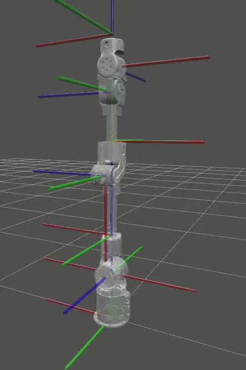
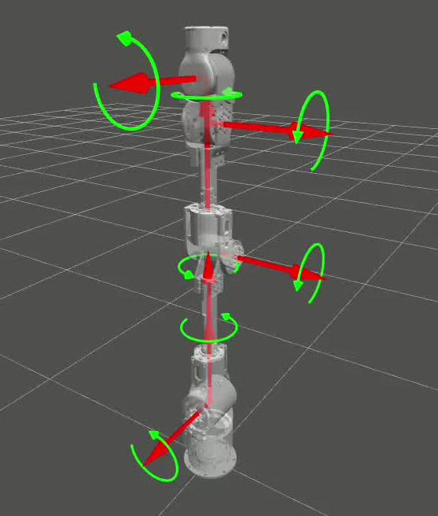

```{=latex}
\begin{titlepage}
\thispagestyle{empty}
\newfontfamily\qsans{Noto Sans CJK SC}
\begin{tikzpicture}[remember picture,overlay]
  % 封面绝对定位，坐标 = 距页面左上角 (pt)。对齐参考封面 LiteArm_Quickstart 首页：
  % 英文名中心 y≈205 / 手册名 y≈262 / 图顶 y≈300 / 品牌行 y≈716 / 版本行 y≈746
  % 品牌 logo（机械臂图形+字标，替换原 LITEARM SE 文字）：图顶 y≈108、高 112pt
  \node[anchor=north,inner sep=0pt] at ($(current page.north west)+(298.75pt,-108.9pt)$)
      {\includegraphics[width=100pt,height=112pt,keepaspectratio]{LITEARM_SE_images/cover_litearm_logo.png}};
  \node[anchor=center] at ($(current page.north west)+(298.75pt,-262.4pt)$)
      {{\fontsize{28}{34}\selectfont\qsans\bfseries 产品手册}};
  \node[anchor=north,inner sep=0pt] at ($(current page.north west)+(298.75pt,-300.8pt)$)
      {\includegraphics[width=289.1pt,height=289.1pt,keepaspectratio]{LITEARM_SE_images/cover_litearm_se.png}};
  \node[anchor=center] at ($(current page.north west)+(298.75pt,-717.8pt)$)
      {{\fontsize{11}{14}\selectfont\bfseries NEXFORM ROBOTICS}};
  \node[anchor=center] at ($(current page.north west)+(298.75pt,-747.9pt)$)
      {{\fontsize{9}{13}\selectfont\qsans 版本：V1.0.4\qquad 日期：2026年10月16日}};
\end{tikzpicture}
\end{titlepage}
\pagenumbering{Roman}
\thispagestyle{frontmatter}
\section*{修订记录}
```

| 版本 | 修订时间 | 修订记录 |
|---|---|---|
| V1.0.4 | 2026-10-16 | 删除「机械臂安装以及使用指南」整章，安装步骤改为指向《LITEARM-SE 机械臂安装教程》；更新常见问题 |
| V1.0.3 | 2026-10-16 | 控制系统改为板载控制板，上位机经 USB 直连；更新电气接口与连接说明 |
| V1.0.2 | 2026-09-03 | 添加安装说明/电气接口说明 |
| V1.0.1 | 2026-08-01 | 新建 LITEARM SE 产品手册框架 |

```{=latex}
\clearpage
\thispagestyle{frontmatter}
\tableofcontents
\clearpage
\pagenumbering{arabic}
\makeatletter\def\fps@figure{H}\makeatother
```


# 前言

LITEARM SE 是 NEXFORM ROBOTICS 面向科研教育、AI 机器人开发与轻量级工业自动化场景设计的 7 自由度协作机械臂，采用模块化关节架构，工作半径约 650 mm。机械臂由一块**板载控制板**统一驱动：控制板运行固件，承担轨迹规划、正逆运动学、动力学与关节控制律；控制板与机械臂本体之间为 CAN 总线（板内总线，用户无需接线或配置），上位机与控制板之间只用**一根 USB 线**直连。PC 侧软件（Python / C++ SDK、ROS 2、URDF、PyBullet/MuJoCo 仿真等）只负责下发命令与读取状态，可用于装配、分拣、抓取、示教与算法验证等场景。

## 硬件组成

标准交付套件的组成如下（最终以销售配置清单为准）：

| 序号 | 设备 | 说明 |
|:---:|---|---|
| 1 | 机械臂本体 | LITEARM SE，7 关节 |
| 2 | 控制板 | 板载控制器，随臂交付 |
| 3 | USB 线 | 控制板 ↔ 上位机 PC |
| 4 | 机械臂电源输出 | 机械臂供电引出线 |
| 5 | 600 W 开关电源套件 | 选配 |
| 6 | 桌面固定套件 | 选配 |
| 7 | 立柱套件 | 选配 |
| 8 | 电动夹爪 | 选配 |
| 9 | 3D 相机 | 选配 |


## 单位说明

本文档及 SDK 中使用的物理量单位约定如下：

| 参数 | 单位 | 说明 |
|---|---|---|
| X / Y / Z | m | 位置，米 |
| R / P / Y | rad | 姿态，弧度 |
| Joint（关节角） | rad | 弧度 |
| vTCP | m/s | 末端线速度 |
| aTCP | m/s² | 末端加速度 |
| vJoint | rad/s | 关节速度 |
| aJoint | rad/s² | 关节加速度 |
| 质量 / 负载 | kg | 千克 |
| 扭矩 | N·m | 牛米 |
| 电压 / 功耗 | VDC / W | 伏特 / 瓦特 |

> **位姿格式约定**：位姿用 **6 个数**表示，前 3 个为位置 `x, y, z`（m），后 3 个为姿态 `rx, ry, rz`（rad，绕基坐标系 X/Y/Z 轴的旋转，即 RPY 角），例如 `(0.30, 0.0, 0.40, 3.1416, 0.0, 0.0)`。Python SDK 中 list 与 tuple 均可（详见《LITEARM SE 软件开发手册》）。

## 安全须知

### 简介

本节介绍使用 LITEARM SE 机器人及系统时需要遵守的安全原则与规范。在安装、使用前，使用者必须认真阅读本手册，带有警示标志的内容需要掌握并严格遵守。机器人系统运行中存在夹持、碰撞、坠落等潜在危险，使用人员应充分认识操作风险，并经过培训后使用 SDK 或控制软件。

### 安全警示标志

本手册其他章节的安全提示使用如下警示标志，警示标志图样如图1所示（图样以产品随附标识为准）：

- **危险**：用于可能导致人员伤亡或设备严重损坏的危险情况。
- **警告**：用于如不避免，可导致人员伤亡或设备严重损坏的危险情况。
- **高温**：用于存在高温部件、接触可能造成灼烫伤害或设备损坏的危险情况。
- **注意**：用于如不避免，可能导致人员伤害或设备损坏的一般警示。

```{=latex}
\begin{figure}[H]
\centering
\makebox[\linewidth][c]{%
\begin{minipage}[b]{0.16\linewidth}\centering
\includegraphics[width=0.95\linewidth,keepaspectratio]{LITEARM_SE_images/safety/danger.png}\\
\scriptsize 危险
\end{minipage}\hspace{0.08\linewidth}%
\begin{minipage}[b]{0.16\linewidth}\centering
\includegraphics[width=0.95\linewidth,keepaspectratio]{LITEARM_SE_images/safety/warning.png}\\
\scriptsize 警告
\end{minipage}}\par\vspace{0.6em}%
\makebox[\linewidth][c]{%
\begin{minipage}[b]{0.16\linewidth}\centering
\includegraphics[width=0.95\linewidth,keepaspectratio]{LITEARM_SE_images/safety/high_temp.png}\\
\scriptsize 高温
\end{minipage}\hspace{0.08\linewidth}%
\begin{minipage}[b]{0.16\linewidth}\centering
\includegraphics[width=0.95\linewidth,keepaspectratio]{LITEARM_SE_images/safety/notice.png}\\
\scriptsize 注意
\end{minipage}}
\caption{安全警示标志}
\end{figure}
```

### 安全注意事项

首次启动机器人或机器人系统前需理解并遵循以下基本信息。

#### 机器人操作注意事项

1. 务必按照本手册要求规范安装机械臂本体、控制板与电气设备。
2. 首次使用前由专业人员对机械臂及防护系统进行初步检查，测试全部安全功能（急停、软限位、使能状态）。
3. 使用前检查设备完整性与安装牢固程度，确认符合所在地区安全生产规章。
4. 确保机械臂有足够大的运动空间，运动范围内无人员、障碍物与易卷入线缆。
5. 使用 SDK / 上位机开发调试前需仔细阅读文档，确保输入参数（目标关节角、速度、负载等）正确。
6. **失能（`disable()`）或异常下电后，关节不再主动输出力矩，机械臂可能在重力作用下坠落。** 进行相关操作前请先让机械臂回到安全姿态，或进入零重力模式由人手托扶，避免高处坠落造成人员伤亡或设备损坏。
7. 运行期间发生意外或异常，应立即按下硬件急停并切断电源，再排查问题。
8. 机械臂的斜率限制、关节软限位、非法值拒绝、通信看门狗与急停兜底均由控制板固件承担，**不依赖上位机是否在线**；但固件只做硬性兜底，非授权人员切勿通过 SDK 随意修改参数（关节限位、PD 增益、负载质量与质心、重力方向等），部分参数修改后需重新进行安全评估。

#### 人员安全

1. 使用人员应仔细阅读产品手册，掌握安全、规范的操作流程及报错处理方式。
2. 设备运转中，即使机械臂看起来已经停止，也可能处于等待指令状态，应视为仍在动作中。
3. 明确机械臂及末端执行器（夹爪、灵巧手等）的动作范围，设置安全工作区。
4. 定期检查机械臂，防止固定螺栓或末端工具松动。
5. 拖拽示教（零重力模式）时，注意机械臂自重与运动惯性，避免突然失力造成伤害；双手离开后机械臂应能保持当前姿态，如不能保持请勿继续操作。

### 责任及规范

机器人可与其他设备组成完整系统，本文档不包含完整系统的全部设计、安装与操作内容。完整系统安装的安全性取决于集成方式，使用者需依据所在国家/地区法律法规与安全规范，对完整系统进行设计与安装风险评估，并采取相应防护措施。

开始使用本机械臂即视为已阅读、理解并接受本手册及安全信息全部条款。使用者承诺对自身行为及后果负责，仅将机械臂用于正当目的。对违反使用要求或不可抗力导致的人身伤害、事故、财产损失等，我司不承担相应责任。使用者需履行但不限于：对完整系统做风险评估、编制操作规程、建立安全措施、确认系统设计安装无误、不擅自修改安全措施。

### 风险评估

风险评估应考虑正常使用及可预见的误操作下人员与机器人之间所有潜在接触，例如：

- 使用尖锐末端执行器或工具连接器的危险；
- 处理有毒或其他有害物质的危险；
- 手指被机械臂底座或关节夹住的危险；
- 被机械臂碰撞的危险；
- 末端工具固定不到位、负载超出范围导致坠落的危险；
- 机械臂负载与坚固表面之间冲击的危险。

使用者须通过风险评估判断相关危险是否构成不可接受的风险并采取相应措施。机械臂不适合无专业人员指导且不具备完全民事行为能力的人士使用。

---

# 技术规格

## 通用规格

| 参数名 | 参数 |
|---|---|
| 产品名称 | LITEARM SE 7 自由度协作机械臂 |
| 安装方式 | 正装 / 侧装 / 倒装 |
| 自由度 | 7 |
| 有效负载/最大负载 | 3 kg / 5 kg |
| 自重 | 5.6 kg |
| 重复定位精度 | ±0.1 mm |
| 工作半径 | 650 mm |
| 供电电压 | DC 24 V |
| 额定功率 | 430 W |
| 速度倍率 | 0.6 ~ 1.0 |
| 电源适配 | 600 W（带泄放） |
| 控制方式 | 板载控制板（随臂交付） |
| 通讯方式 | USB（上位机 PC ↔ 控制板）+ CAN（控制板 ↔ 关节，板内总线，用户不接线、不配置） |
| 材质 | 金属 + 高强度工程塑料复合机身 |

## 控制板规格

| 参数名 | 参数 |
|---|---|
| 名称 | 控制板（随臂交付） |
| 作用 | 承担轨迹规划、运动学、动力学与控制律，并管理急停、软限位等安全兜底 |
| 固件版本 | 出厂固件版本串形如 `Litearm1.5.0-7J`（`Litearm` + 三段版本号 + `-7J`，7J 表示七轴），SDK 要求 `Litearm1.5.0` 及以上 |
| 供电输入 | DC 24 V（XT60 接口） |
| 上位机接口 | USB（虚拟串口） |
| 关节接口 | 接机械臂下方接口 |
| 参数存储 | 板载存储，出厂已完成逐台动力学标定 |


## 关节参数

为保证运行安全，机械臂关节角度限位带有软件软限位，**固化在控制板固件中**，运动时由固件实时校验。可通过 SDK 逐关节查询与配置（修改前需安全评估）：

```python
for jp in arm.params.all_joint_params():      # 逐关节读回
    print(jp.idx, jp.q_min, jp.q_max)         # 也可单轴读：arm.params.get_joint_param(0)
arm.params.set_joint_limits(0, -2.8, 2.8)     # 逐关节写：只允许收窄
```

> `params.set_joint_limits()` **只允许把限位收窄**，写回当前值会被判为放宽请求并拒绝，写入后需 `save_params()` 才持久化（写 Flash，不可逆）。下表为出厂标称范围，实际生效值请以 SDK 读回的为准：

| 关节（URDF） | SDK 索引 | 角色 | 运动范围（rad） | 运动范围（°） | 最大速度（标称） |
|---|---|---|---|---|---|
| Joint1 | q[0] | 基座旋转 | −2.809547 ~ 2.809547 | −161° ~ 161° | 180°/s |
| Joint2 | q[1] | 肩部俯仰 | −1.727547 ~ 1.727547 | −99° ~ 99° | 180°/s |
| Joint3 | q[2] | 肘部俯仰 | −2.809547 ~ 2.809547 | −161° ~ 161° | 180°/s |
| Joint4 | q[3] | 腕部旋转 | −3.071547 ~ 0.017547 | −176° ~ +1° | 225°/s |
| Joint5 | q[4] | 腕部俯仰 | −2.809547 ~ 2.809547 | −161° ~ 161° | 225°/s |
| Joint6 | q[5] | 腕部偏转 | −1.553547 ~ 1.553547 | −89° ~ 89° | 225°/s |
| Joint7 | q[6] | 末端旋转 | −1.553547 ~ 1.553547 | −89° ~ 89° | 225°/s |

> **说明**
> 1. 关节速度：URDF 中默认速度上限为 1 rad/s，仅为仿真参考值，不代表最大能力。
> 2. Joint4 区间：软限位为不对称区间（−176° ~ +1°）。
> 3. 关节最大扭矩：肩部最大约 97 N·m；其余关节扭矩上限以固件逐关节参数 `tau_max` 为准（SDK `arm.params.get_joint_param(idx).value.tau_max` 读回），URDF 中 `effort` 参考值为 Joint1/2=30、Joint3/4=9、Joint5/6/7=3.5 N·m。

## 图示

### 机械臂零位与坐标系

- 机械臂默认安装（台面安装、基座水平）时，基坐标系以基座安装面中心为原点，Z 轴竖直向上（与默认重力方向相反），X/Y 轴按右手定则位于安装面内；工具坐标系（TCP）位于末端法兰处，基坐标系与工具坐标系的标注如图2所示。实际朝向请以 URDF/仿真（base_link 与 ee_frame_link）或实机为准。



- 安装方向（正装 / 侧装 / 倒装）通过重力补偿参数体现，可经 SDK `set_gravity_vector(g)` 指定重力方向、`set_gravity_scale(gs)` 逐关节缩放重力前馈；配置错误会直接导致重力补偿失准。

### 关节旋转方向

各关节绕其 URDF 定义的旋转轴、按**右手定则**确定正方向，各关节旋转方向标注如图3所示。可在 PyBullet / MuJoCo 仿真中或上位机实时控制下验证各关节旋转方向。



---

# 常见问题

## Q&A

**问：机械臂有哪些控制/运行模式？**
答：LITEARM SE 支持关节空间运动（`movej`）、笛卡尔直线/圆弧/多路点运动（`move_l`/`move_c`/`move_path`）、笛卡尔点到点（`move_p`）、回零（`home`）、零重力拖动示教（`zero_g`）等（详见开发手册）。运动前确认机械臂处于使能且非急停状态。

**问：关节空间和笛卡尔空间有什么区别？**
答：关节空间直接控制每个关节角度，简单直接、不易出现奇异点，适合点到点运动；笛卡尔空间控制末端位姿，适合需要直线/圆弧等精确轨迹的任务，规划更复杂且可能遇到奇异点。

**问：上电后/复位后机械臂无法运动？**
答：请依次检查：机械臂是否处于急停或故障状态、是否已使能。按安全流程依次执行 `reset()`、`clear_faults()`、`enable()` 后再运动；若 `enable()` 被拒，请读取 `get_state()` 中的故障轴信息（详见开发手册）。

**问：如何安全地进行拖拽示教？**
答：进入零重力模式（`zero_g()`）后双手缓慢拖动机械臂到目标姿态；拖动范围不要超过关节软限位；停止拖动后确认机械臂能保持姿态；示教完成后退出零重力模式并让机械臂保持/回到安全姿态。

**问：为什么 `disable()` 后机械臂会掉落？**
答：失能后关节不再输出力矩，机械臂会在重力作用下坠落。请在机械臂有支撑、无人员靠近时操作，或先 `home()` 回到安全姿态。

**问：连接不上机械臂怎么办？**
答：依次检查：USB 线是否接在控制板与上位机之间；`lsusb` 中是否存在 VID:PID 为 `1d50:606f` 的设备（没有则查线缆与供电）；Linux 下当前用户是否已加入 `dialout` 组；串口是否被另一个进程占用；固件版本是否达到 `Litearm1.5.0`。仍无法解决请联系技术支持。

**问：技术支持渠道？**
答：NEXFORM ROBOTICS 技术团队；GitHub 组织 [github.com/nexform-tech](https://github.com/nexform-tech)（Issues）。

---

# 参考文档与技术支持

本手册覆盖产品外观、技术规格与安全须知。**机械装配与电气连接已单独成册**，请配合阅读：

| 文档 | 内容 | 地址 |
|---|---|---|
| LITEARM-SE 机械臂安装教程 | 开箱清点、桌面固定、立柱安装、电气连接与接线自检 | <https://github.com/nexform-tech/litearm-setup> |
| LITEARM SE 软件开发手册 | SDK（Python / C++ / ROS 2）、上位机软件、状态与报错 | <https://github.com/nexform-tech/litearm-python> |

SDK、上位机软件（LiteArm Studio）与其它相关文档的下载地址：<https://github.com/nexform-tech>

---

> **文档结束**　如有疑问或需要补充信息，请联系 NEXFORM ROBOTICS 技术团队。
