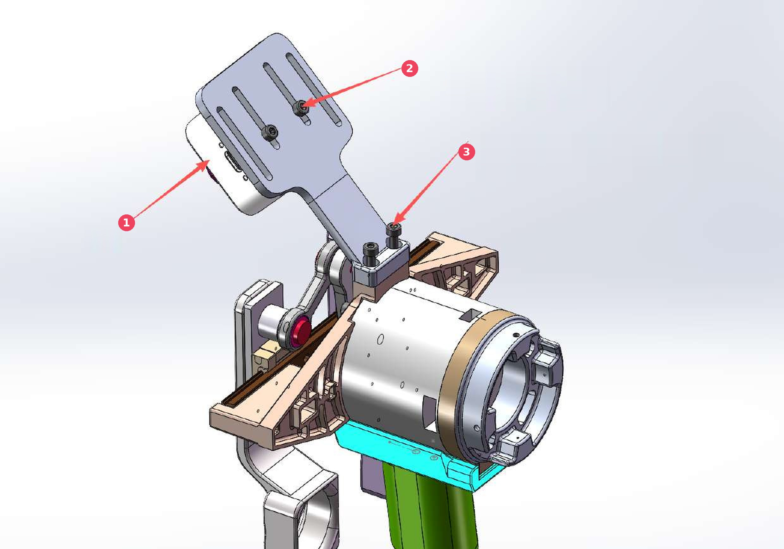
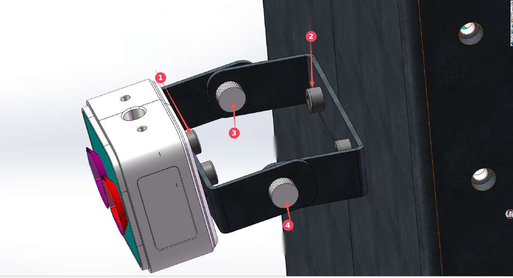
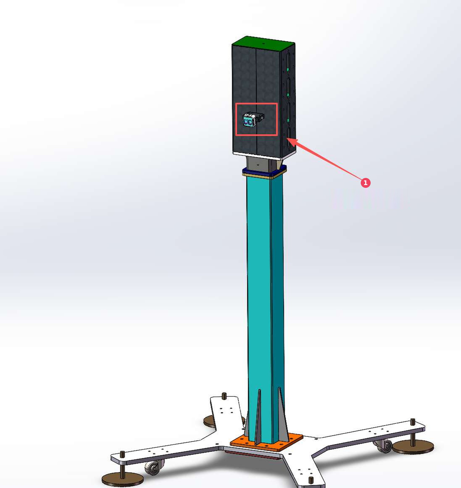

# Camera bracket mounting and use

Version: V1.0.0　　2026-11-06

The camera bracket holds the camera on a LiteGrip gripper or holder, and the
whole bracket can also be fixed to the column, for vision capture and hand-eye
calibration. The three figures below follow the mounting positions; the numbers
in each table match the red markers in the figure.

## On the gripper or holder

| No. | Item | Description |
| --- | -------- | ------------------------- |
| 1 | Camera | The camera sits on the bracket, looking past the gripper |
| 2 | Fixing the camera | Two M3×6–M3×8 screws through the bracket holes fix the camera |
| 3 | Fixing the bracket | Two M3×6 socket head cap screws mount the bracket onto the holes on the holder or gripper, as shown |

## Fixing and adjusting the bracket

| No. | Item | Description |
| --- | -------- | ------------------------- |
| 1 | Fixing the camera | Two M3×6–M3×8 socket head cap screws fix the camera to the bracket |
| 2 | Fixing the bracket | Two M4×8 socket head cap screws fix the bracket to the outer face of the column |
| 3 | Rotation | Two M3 thumb nuts lock and adjust the rotation of the bracket |
| 4 | Adjustment | Two M3 thumb screws lock and adjust the bracket |

## Mounting position on the column

| No. | Item | Description |
| --- | -------- | ------------------------- |
| 1 | Camera bracket mounting position | The bracket is fixed to the side of the box on top of the column, in the red frame |
