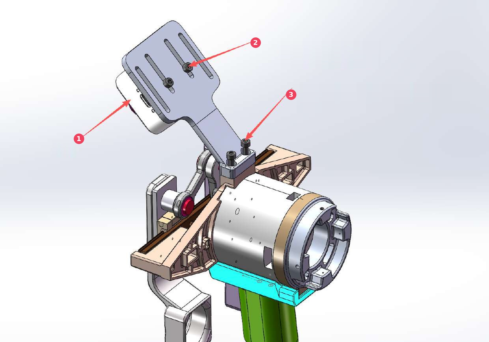
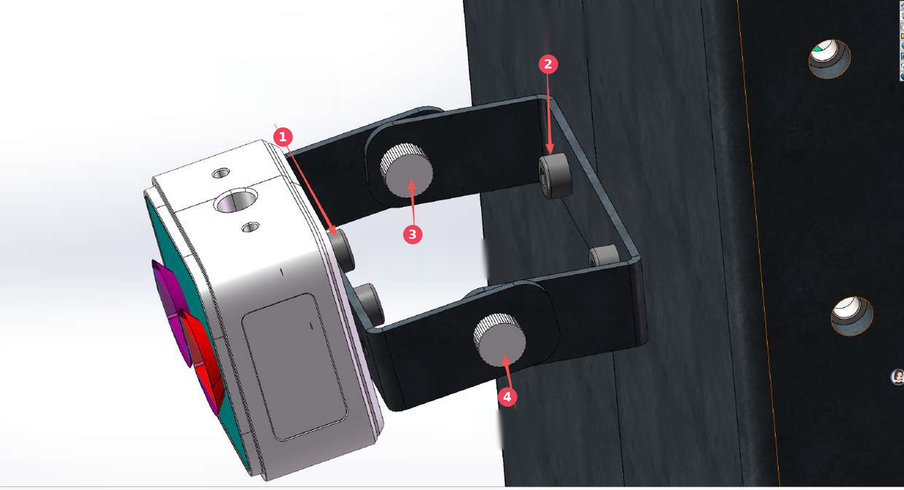
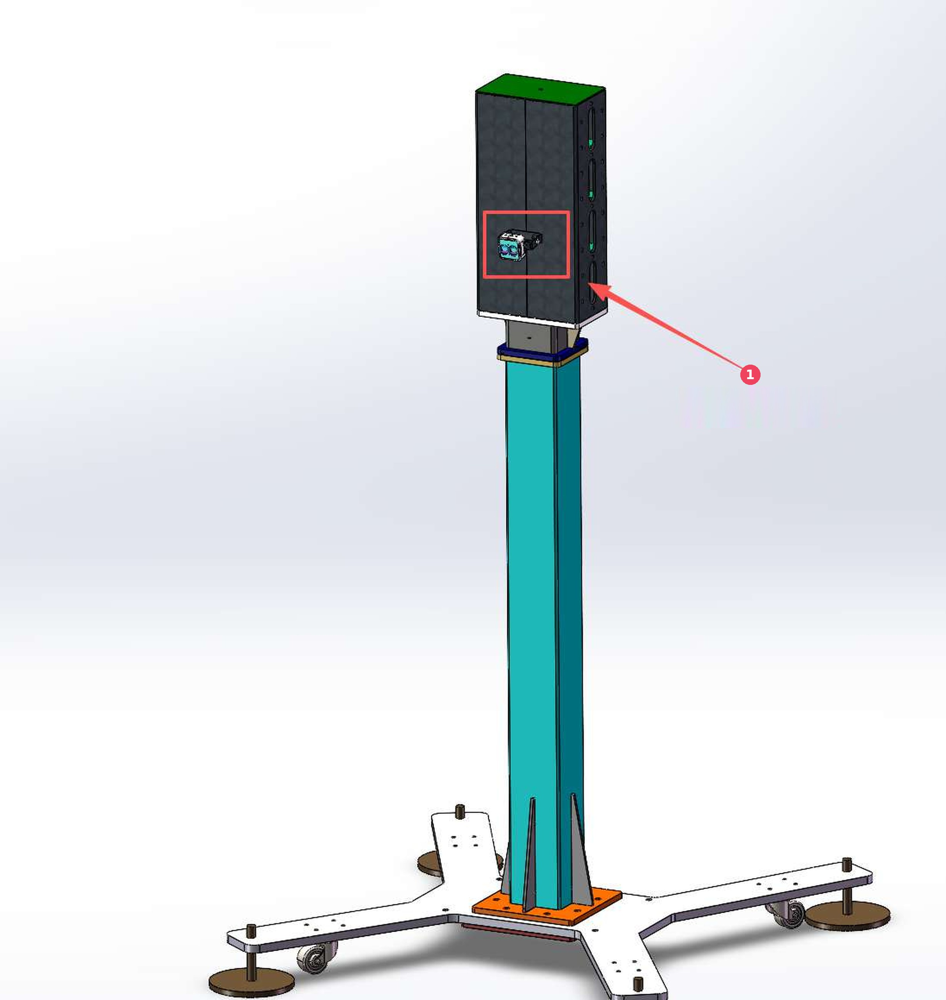

# 相机支架安装使用方式

版本：V1.0.0　　日期：2026-11-06

相机支架把相机固定在 LiteGrip 夹爪或夹持器上，也可以把整个支架固定在立柱上，供视觉采集
与手眼标定使用。下面三幅图按安装位置说明安装方式，表格里的编号与图中红色圆圈一一对应。

## 装在夹爪或夹持器上

| 编号 | 位置 | 说明 |
| --- | -------- | ------------------------- |
| 1 | 相机 | 相机装在相机支架上，镜头朝向夹爪前方 |
| 2 | 固定相机 | 将 2 个 M3×6~M3×8 的螺钉装在相机支架孔内，固定相机 |
| 3 | 固定支架 | 使用 2 个圆柱头内六角 M3×6 螺钉，将相机支架装在夹持器或夹爪上的孔位，如图所示 |

## 相机支架的固定与调节

| 编号 | 位置 | 说明 |
| --- | -------- | ------------------------- |
| 1 | 固定相机 | 2 个圆柱头内六角 M3×6~M3×8 螺钉，将相机固定在相机支架上 |
| 2 | 固定支架 | 2 个圆柱头内六角 M4×8 螺钉，将相机支架固定在立柱外侧表面上 |
| 3 | 调节旋转角度 | 2 个 M3 手拧螺母，固定及调节相机支架的旋转角度 |
| 4 | 调节支架 | 2 个 M3 手拧螺丝，固定及调节相机支架 |

## 立柱上的安装位置

| 编号 | 位置 | 说明 |
| --- | -------- | ------------------------- |
| 1 | 相机支架装置处 | 相机支架装在立柱顶部箱体的侧面，如图中红框所示 |
